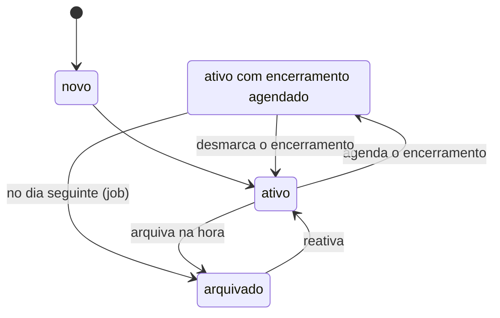
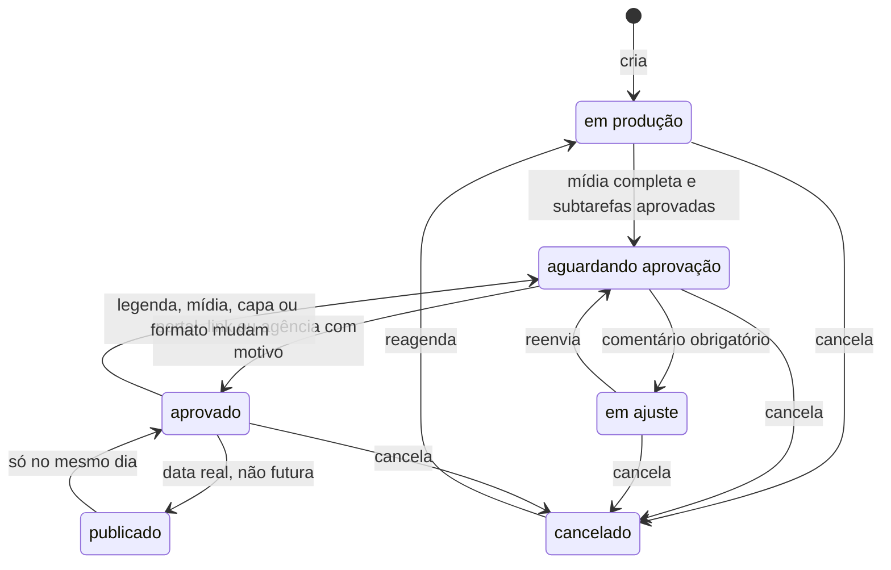
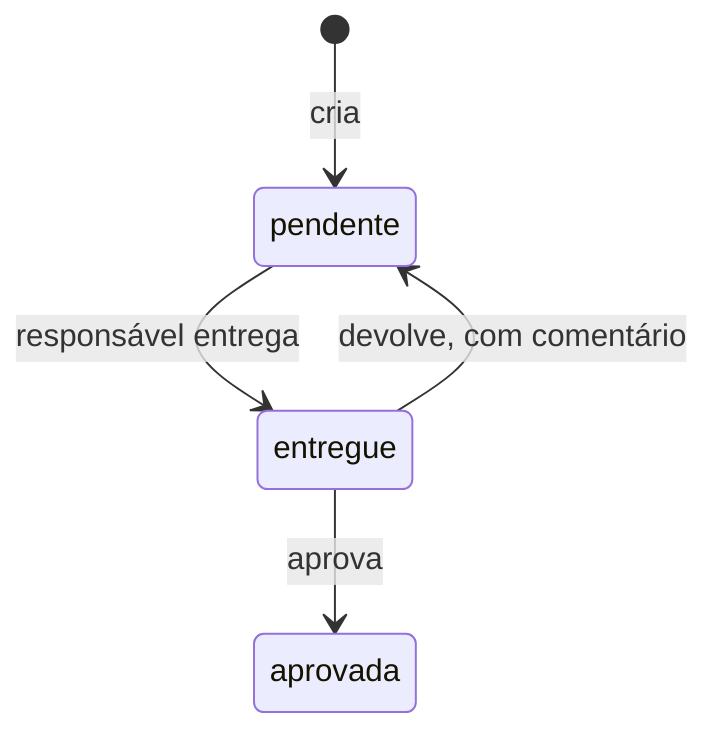
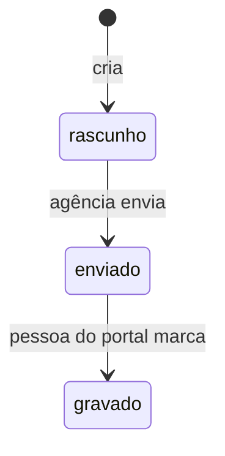
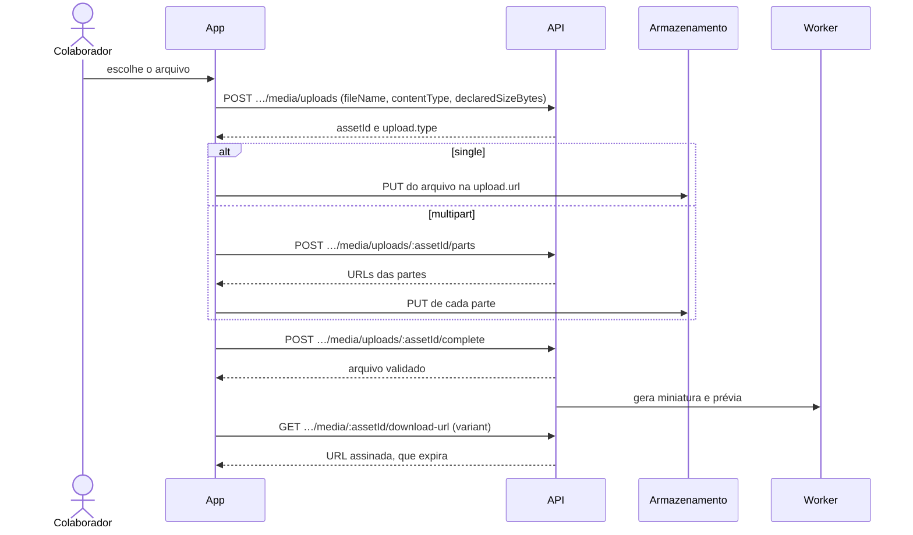
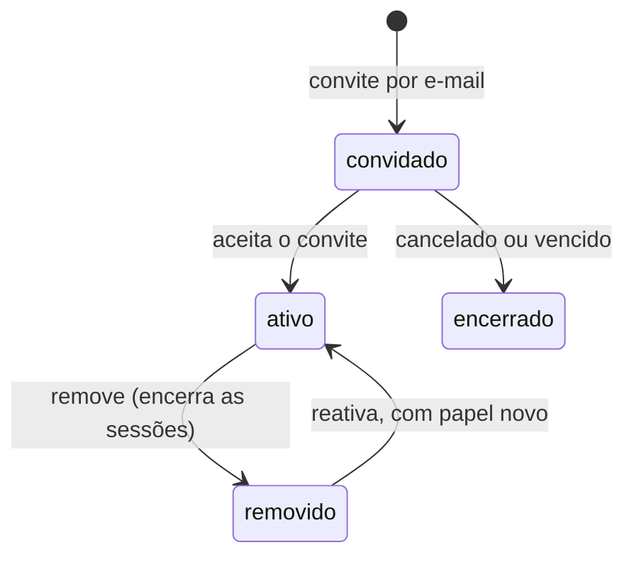

# Agência

A equipe da agência, no contexto `agency`. Todas as rotas começam com `/agencies/:agencyId`; nas tabelas, `…` substitui esse prefixo. Corpo, resposta e erros de cada rota estão na [referência da API](../../api/README.md).

## Antes de tudo: permissões, papéis e plano

1. Ao entrar na agência, chame `GET …/me`. Ele devolve as **permissões efetivas** da pessoa e o **plano**: `kind` (`trial`, `ativo` ou `isenta`), `trialEndsAt` e `readOnly`.
2. Mostre ou esconda as ações pela permissão. Quem não tem a permissão recebe `403 FORBIDDEN` do backend de qualquer jeito.

| método | rota | permissão | o que faz |
|---|---|---|---|
| `GET` | `…/me` | vínculo com a agência | permissões efetivas e plano do contexto |

**Quem pode o quê** (papéis de sistema; a agência ainda não cria papéis próprios pelo produto):

| área | Admin | Gestor de conta | Produção | Vendas | Financeiro |
|---|:-:|:-:|:-:|:-:|:-:|
| ver clientes, estudo de marca e conversas | ✅ | ✅ | ✅ | ✅ | ✅ |
| editar cliente, estudo e personas; responder e resolver conversa | ✅ | ✅ | | | |
| cadastrar cliente | ✅ | ✅ | | | |
| agendar encerramento, arquivar e reativar cliente | ✅ | | | | |
| gerir as pessoas do portal | ✅ | | | | |
| ver conteúdos, calendário, pastas e roteiros | ✅ | ✅ | ✅ | | |
| criar e editar conteúdo, mídia, subtarefas e roteiros; enviar para aprovação; publicar | ✅ | ✅ | ✅ | | |
| aprovar fora da plataforma; cancelar conteúdo | ✅ | ✅ | | | |
| ver a equipe | ✅ | ✅ | ✅ | ✅ | ✅ |
| editar o cargo de outra pessoa | ✅ | ✅ | | | |
| convidar, remover, reativar e trocar papel | ✅ | | | | |

- O **Owner** não é um papel: é quem criou a agência, e ele passa em tudo. **Só o Owner gerencia a assinatura**, e só ele concede o papel Admin.
- **Cargo não é papel.** O cargo (`jobTitle`) descreve o trabalho e não dá acesso.
- Vendas e Financeiro **não veem conteúdo**, nem os indicadores que vêm dele.

**Teste grátis e modo leitura**

- A agência nasce em teste de **14 dias**, com até **3 clientes**, **3 colaboradores** e **2 GB**. O Owner e os convites pendentes contam como colaboradores.
- A agência fica **somente leitura** ao fim do teste sem assinatura ou ao fim do período de uma assinatura cancelada:
  - tudo continua visível e nada é apagado;
  - a escrita é recusada com `409 AGENCY_READ_ONLY`;
  - continuam liberados remover colaborador, remover acesso ao portal e cancelar convite;
  - mostre um aviso no topo de que o plano precisa ser renovado.
- Erros ao estourar um limite:
  - `409 TRIAL_CLIENT_LIMIT`, `409 PLAN_CLIENT_LIMIT` e `409 TRIAL_COLLABORATOR_LIMIT`;
  - `409 QUOTA_EXCEEDED` para armazenamento;
  - `429 DAILY_EMAIL_LIMIT` nos convites: 20 e-mails por dia no teste e 200 nos planos.

**Listas.** São paginadas, com `pageSize` de no máximo 100. Itens arquivados só aparecem quando pedidos.

## Clientes

| método | rota | permissão | o que faz |
|---|---|---|---|
| `GET` | `…/clients` | `cliente.visualizar` | carteira na ordem de triagem |
| `POST` | `…/clients` | `cliente.cadastrar` | cadastra (só o nome é obrigatório) |
| `GET` | `…/clients/:clientId` | `cliente.visualizar` | detalhe com o resumo da aba Geral |
| `PATCH` | `…/clients/:clientId` | `cliente.operar` | edita o cadastro |
| `PUT` | `…/clients/:clientId/photo` | `cliente.operar` | envia a foto |
| `DELETE` | `…/clients/:clientId/photo` | `cliente.operar` | remove a foto |
| `PUT` | `…/clients/:clientId/closing` | `cliente.arquivar` | agenda o encerramento |
| `DELETE` | `…/clients/:clientId/closing` | `cliente.arquivar` | desmarca o encerramento |
| `POST` | `…/clients/:clientId/archive` | `cliente.arquivar` | arquiva agora |
| `POST` | `…/clients/:clientId/reactivate` | `cliente.arquivar` | reativa |

**Ciclo do cliente**

- Com o encerramento agendado, tudo funciona até o fim da data, inclusive o portal. No dia seguinte, um job arquiva o cliente.
- **Arquivar:**
  - o portal fica inacessível na hora;
  - os convites de portal pendentes são revogados;
  - os conteúdos com data depois do encerramento viram cancelados e não voltam sozinhos;
  - os acessos são preservados: reativar devolve o portal a quem tinha.
- **Cliente arquivado é só leitura.** A única ação é reativar; as demais recebem `409 CLIENT_ARCHIVED`.
- Dois clientes ativos não podem ter o mesmo nome, sem diferenciar maiúsculas. Reativar um cliente cujo nome já está em uso é recusado.
- Todo colaborador vê todos os clientes. Não há atribuição de cliente a pessoa.

## Estudo de marca e personas

| método | rota | permissão | o que faz |
|---|---|---|---|
| `GET` | `…/clients/:clientId/brand-study` | `cliente.visualizar` | as sete seções e as personas |
| `PUT` | `…/clients/:clientId/brand-study/sections/:sectionKey` | `cliente.operar` | grava uma seção |
| `POST` | `…/clients/:clientId/personas` | `cliente.operar` | cria uma persona |
| `PATCH` | `…/clients/:clientId/personas/:personaId` | `cliente.operar` | edita uma persona |
| `POST` | `…/clients/:clientId/personas/:personaId/archive` | `cliente.operar` | arquiva (some do portal) |
| `POST` | `…/clients/:clientId/personas/:personaId/unarchive` | `cliente.operar` | desarquiva |

## Conversas com o cliente

| método | rota | permissão | o que faz |
|---|---|---|---|
| `GET` | `…/clients/:clientId/threads` | `cliente.visualizar` ou `conteudo.visualizar` | conversas de um assunto |
| `POST` | `…/clients/:clientId/threads` | `cliente.operar` ou `conteudo.operar` | abre uma conversa com o primeiro comentário |
| `GET` | `…/clients/:clientId/threads/:threadId/comments` | `cliente.visualizar` ou `conteudo.visualizar` | comentários |
| `POST` | `…/clients/:clientId/threads/:threadId/comments` | `cliente.operar` ou `conteudo.operar` | comenta |
| `POST` | `…/clients/:clientId/threads/:threadId/resolve` | `cliente.operar` ou `conteudo.operar` | resolve |

- **Não existe conversa interna.** Toda conversa é visível ao cliente dela.
- O estado da conversa é calculado, não gravado:
  - ela está **resolvida** se foi resolvida depois do último comentário;
  - qualquer comentário novo a **reabre**, então não existe ação de "reabrir";
  - "aguardando a agência" é a conversa aberta cujo último comentário é do cliente.
- Comentário não se edita nem se apaga. Só a agência resolve conversas.

## Pessoas do portal do cliente

| método | rota | permissão | o que faz |
|---|---|---|---|
| `GET` | `…/clients/:clientId/members` | `cliente.convidar_usuario` | quem tem acesso |
| `POST` | `…/clients/:clientId/members` | `cliente.convidar_usuario` | adiciona uma pessoa (manda o e-mail de boas-vindas) |
| `POST` | `…/clients/:clientId/members/:accessId/resend` | `cliente.convidar_usuario` | reenvia o e-mail a quem ainda não entrou |
| `POST` | `…/clients/:clientId/members/:accessId/remove` | `cliente.remover_usuario` | remove (encerra as sessões da pessoa) |
| `POST` | `…/clients/:clientId/members/:accessId/reactivate` | `cliente.remover_usuario` | reativa, sem convite |
| `GET` | `…/clients/:clientId/invitations` | `cliente.convidar_usuario` | convites antigos ainda pendentes |
| `POST` | `…/clients/:clientId/invitations/:invitationId/resend` | `cliente.convidar_usuario` | transforma um convite antigo em acesso |

- A pessoa do portal não tem papel. Todas as pessoas de um cliente podem as mesmas coisas.
- Um colaborador da agência, mesmo o Owner, **não entra no portal** sem um acesso próprio àquele cliente.

## Conteúdos

| método | rota | permissão | o que faz |
|---|---|---|---|
| `GET` | `…/clients/:clientId/contents` | `conteudo.visualizar` | conteúdos e roteiros de um período (calendário e feed em tela cheia) |
| `GET` | `…/clients/:clientId/contents/feed?cursor=` | `conteudo.visualizar` | o feed inteiro do cliente (image, carousel e reels não cancelados), do mais recente ao mais antigo, 9 por página; os contadores só vêm na primeira página (`null` nas outras) e há limite de 300 leituras por minuto por pessoa (`429 RATE_LIMITED` com `Retry-After`) |
| `POST` | `…/clients/:clientId/contents` | `conteudo.operar` | cria, em produção. Sem `mediaAssetIds` no corpo, o conteúdo **herda a mídia da pasta** (a que serve ao formato); com a lista, vale a lista, e `[]` cria sem mídia |
| `GET` | `…/clients/:clientId/contents/:contentId` | `conteudo.visualizar` | detalhe com as mídias, as subtarefas e a conversa |
| `PATCH` | `…/clients/:clientId/contents/:contentId` | `conteudo.operar` | edita; mudar a data é editar `publishOn` |
| `POST` | `…/clients/:clientId/contents/:contentId/submit` | `conteudo.operar` | envia para aprovação (ou reenvia depois do ajuste) |
| `POST` | `…/clients/:clientId/contents/:contentId/approve-by-agency` | `conteudo.aprovar_pela_agencia` | registra uma aprovação feita fora da plataforma, com motivo |
| `POST` | `…/clients/:clientId/contents/:contentId/publish` | `conteudo.publicar` | marca como publicado |
| `POST` | `…/clients/:clientId/contents/:contentId/unpublish` | `conteudo.publicar` | desfaz a publicação, só no mesmo dia |
| `POST` | `…/clients/:clientId/contents/:contentId/cancel` | `conteudo.cancelar` | cancela (o conteúdo fica guardado) |
| `POST` | `…/clients/:clientId/contents/:contentId/reschedule` | `conteudo.operar` | reagenda um conteúdo cancelado |

Formatos: `image`, `carousel`, `reels`, `long_video` e `vsl`. Plataforma: `instagram`.

**Estados do conteúdo**

| de | para | quem | condição |
|---|---|---|---|
| em produção (`in_production`) | aguardando aprovação | `conteudo.operar` | mídia completa para o formato e todas as subtarefas aprovadas |
| aguardando aprovação (`awaiting_approval`) | aprovado | pessoa do portal, link de aprovação, ou `conteudo.aprovar_pela_agencia` com motivo | — |
| aguardando aprovação | em ajuste (`adjusting`) | pessoa do portal ou link de aprovação | comentário obrigatório |
| em ajuste | aguardando aprovação | `conteudo.operar` | reenviar |
| aprovado (`approved`) | publicado (`published`) | `conteudo.publicar` | data real, não futura |
| publicado | aprovado | `conteudo.publicar` | só no mesmo dia |
| qualquer um, menos publicado | cancelado (`cancelled`) | `conteudo.cancelar`, ou o arquivamento do cliente | — |
| cancelado | em produção | `conteudo.operar` | reagendar |
| aprovado | aguardando aprovação | automático | ao mudar a legenda, a mídia, a capa ou o formato |

- Não existe caminho direto de "em produção" para "aprovado".
- Mudar a data, a hora, o título, o responsável ou as subtarefas **mantém** a aprovação.
- A data pode mudar em qualquer estado, menos publicado e cancelado.
- Na agência, "aprovado" aparece como **pronto para publicar**; no portal, como **Aprovado**.
- **Atrasado** e **prazo em dois dias** são calculados a partir da data; não são estados.
- Conteúdo nunca é apagado.

## Subtarefas

| método | rota | permissão | o que faz |
|---|---|---|---|
| `POST` | `…/clients/:clientId/contents/:contentId/tasks` | `conteudo.operar` | cria |
| `PATCH` | `…/clients/:clientId/contents/:contentId/tasks/:taskId` | `conteudo.operar` | edita |
| `POST` | `…/clients/:clientId/contents/:contentId/tasks/:taskId/deliver` | `conteudo.visualizar`, sendo o responsável pela subtarefa | entrega |
| `POST` | `…/clients/:clientId/contents/:contentId/tasks/:taskId/approve` | `conteudo.visualizar`, sendo o responsável pelo conteúdo, ou `conteudo.aprovar_pela_agencia` | aprova |
| `POST` | `…/clients/:clientId/contents/:contentId/tasks/:taskId/return` | as mesmas de aprovar | devolve, com comentário |

- O responsável é um colaborador ativo da agência. A subtarefa fica atrasada quando o prazo passa sem ela estar aprovada.
- O portal nunca vê subtarefa.

## Roteiros de stories

| método | rota | permissão | o que faz |
|---|---|---|---|
| `POST` | `…/clients/:clientId/story-scripts` | `conteudo.operar` | cria, em rascunho |
| `GET` | `…/clients/:clientId/story-scripts/:scriptId` | `conteudo.visualizar` | lê, com as cenas |
| `PATCH` | `…/clients/:clientId/story-scripts/:scriptId` | `conteudo.operar` | edita o dia e as cenas (só em rascunho) |
| `POST` | `…/clients/:clientId/story-scripts/:scriptId/send` | `conteudo.operar` | envia ao cliente |

- Ao ser enviado, o roteiro passa a aparecer no portal.
- Quem marca como gravado é a pessoa do portal.
- A lista de roteiros vem junto com a lista de conteúdos do período.

## Mídias

| método | rota | permissão | o que faz |
|---|---|---|---|
| `POST` | `…/media/uploads` | `midia.enviar` ou `conteudo.operar` | inicia o upload e devolve a URL assinada, simples ou multipart |
| `POST` | `…/media/uploads/:assetId/parts` | `midia.enviar` ou `conteudo.operar` | URLs das partes do multipart |
| `POST` | `…/media/uploads/:assetId/complete` | `midia.enviar` ou `conteudo.operar` | confirma o upload e valida o arquivo |
| `GET` | `…/media/:assetId/download-url` | `midia.enviar` ou `conteudo.visualizar` | URL assinada de leitura |
| `GET` | `…/clients/:clientId/media-folders` | `conteudo.visualizar` | pastas do cliente |
| `POST` | `…/clients/:clientId/media-folders` | `conteudo.operar` | cria uma pasta |
| `GET` | `…/clients/:clientId/media-folders/:folderId/assets` | `conteudo.visualizar` | mídias da pasta |
| `POST` | `…/clients/:clientId/media-folders/:folderId/assets/:assetId/remove` | `conteudo.operar` | remove da pasta |

**Fluxo de upload**

1. `POST …/media/uploads` com `fileName`, `contentType` e `declaredSizeBytes`.
2. O campo `upload.type` da resposta diz como enviar:
   - `single`: faça `PUT` do arquivo direto na `upload.url`. Ele vai ao armazenamento, não à API;
   - `multipart`: peça as URLs das partes em `…/parts` e envie cada parte.
3. `POST …/media/uploads/:assetId/complete` confirma. O processamento (miniatura e prévia) acontece depois, num worker.
4. Para exibir, use `GET …/media/:assetId/download-url`, com `variant` igual a `original`, `thumbnail` ou `preview`. A URL expira; peça outra quando isso acontecer.

**Regras**
- Só imagem e vídeo; outros tipos recebem `415 UNSUPPORTED_MEDIA_TYPE`.
- A mídia conta na cota da agência (`409 QUOTA_EXCEEDED`).
- Um conteúdo só usa mídias da pasta do próprio cliente.
- Escolher a pasta dá ao conteúdo a mídia que serve ao formato (carrossel: toda, até 20; os outros: a primeira), uma vez; mídia nova na pasta não entra em conteúdo existente. Trocar a pasta é permitido e substitui a mídia e a capa: o aprovado volta para "aguardando aprovação", e o app confirma antes. Pasta vazia deixa o conteúdo sem mídia; um conteúdo que aguarda ou está aprovado recusa a troca que o deixa sem mídia, e `mediaAssetIds: []` nele também volta `CONTENT_MEDIA_INCOMPLETE`. O envio de arquivo na criação do conteúdo vai para a pasta e entra no conteúdo. `CONTENT_FOLDER_IN_USE` não existe mais.
- Mídia usada em conteúdo aguardando aprovação, aprovado ou publicado não pode ser removida.

## Equipe

| método | rota | permissão | o que faz |
|---|---|---|---|
| `GET` | `…/collaborators` | `colaborador.visualizar` | lista paginada, com busca e filtros (24 por página por padrão) |
| `GET` | `…/collaborators/:membershipId` | `colaborador.visualizar` | um colaborador |
| `GET` | `…/collaborators/job-titles` | `colaborador.visualizar` | cargos que existem na agência |
| `PATCH` | `…/collaborators/:membershipId` | `colaborador.alterar_funcao` (cargo) ou `colaborador.alterar_papel` (papel) | altera o cargo e/ou o papel |
| `POST` | `…/collaborators/:membershipId/remove` | `colaborador.remover` | remove do quadro |
| `POST` | `…/collaborators/:membershipId/reactivate` | `colaborador.alterar_papel` | reativa; o papel novo é obrigatório |
| `GET` | `…/roles` | `colaborador.convidar` ou `colaborador.alterar_papel` | papéis que podem ser atribuídos |
| `GET` | `…/invitations` | `colaborador.convidar` | convites pendentes |
| `POST` | `…/invitations/collaborators` | `colaborador.convidar` | convida por e-mail, com o papel |
| `POST` | `…/invitations/:invitationId/resend` | `convite.reenviar` | reenvia |
| `DELETE` | `…/invitations/:invitationId` | `convite.cancelar` | cancela |

**Ciclo do colaborador**

**Regras**
- Ninguém altera o próprio papel nem remove a si mesmo.
- O Owner não é removido nem tem o papel ou o cargo alterado.
- Dar o papel Admin, seja no convite, na troca ou na reativação, é só com o Owner.
- **Remover uma pessoa encerra todas as sessões dela**, em todos os aparelhos. A próxima chamada dela recebe `401`, e o app deve tratar `401` mandando para o login.
- Reativar nunca herda o papel antigo: o papel vem de novo no corpo da requisição.
- Os removidos só aparecem na lista para quem pode remover ou trocar papel.
- Erros de estado: `409 COLLABORATOR_ALREADY_REMOVED`, `409 COLLABORATOR_NOT_REMOVED` e `409 MEMBERSHIP_EXISTS`.

## Assinatura (só o Owner)

Todas as rotas abaixo exigem `assinatura.gerenciar`, que só o Owner tem.

| método | rota | o que faz |
|---|---|---|
| `GET` | `…/subscription/plans` | planos e preço dos extras |
| `GET` | `…/subscription` | assinatura atual, uso e tolerância |
| `POST` | `…/subscription/quote` | calcula o que uma mudança faz e custa, sem cobrar |
| `POST` | `…/subscription/charges` | pede a mudança e abre a cobrança |
| `POST` | `…/subscription/cancel` | cancela |
| `POST` | `…/subscription/reactivate` | desfaz o cancelamento, até o fim do período |
| `POST` | `…/subscription/charges/:chargeId/simulated-payment` | **só fora de produção**: paga com o provedor simulado |
| `POST` | `…/subscription/simulated-period-advance` | **só fora de produção**: avança o relógio da assinatura |

**Planos**

| plano | clientes | armazenamento | preço por mês |
|---|---|---|---|
| Essencial | 10 | 20 GB | R$ 97 |
| Profissional | 30 | 100 GB | R$ 197 |
| Agência | 60 | 300 GB | R$ 397 |

Colaboradores são ilimitados, e o portal do cliente é grátis. Os extras são por unidade: R$ 6 por cliente e R$ 0,40 por GB.

**Regras**
- O **upgrade** vale na hora e é cobrado proporcional ao que falta do período.
- O **downgrade** vale no próximo ciclo e nunca fica abaixo do uso atual.
- **Cancelar** mantém o acesso até o fim do período pago; depois, a agência fica em modo leitura. Dá para reativar até o fim do período.
- O pagamento atrasado tem **3 dias de tolerância**. Cancelar durante a tolerância leva direto ao modo leitura.
- No Expo, a consulta mostra uso e limites de clientes/armazenamento, fim do período, próxima mensalidade e redução agendada. `graceEndsOn` gera o aviso de pagamento com a data recebida; `plan.readOnly` determina o modo leitura, sem inferir acesso pelo relógio do aparelho. Datas de instantes usam São Paulo; o dia de tolerância não passa por conversão de fuso.
- Falha de carregamento da assinatura oferece uma nova leitura das três rotas, sem criar cobrança. A cotação continua separada de contratação e pagamento.
- Chame sempre `quote` antes de `charges`, para mostrar o valor à pessoa.
- **Tela da web (#773), o fluxo que o app segue igual:**
  1. Abra a assinatura com `GET …/subscription/plans` e `GET …/subscription`; `paymentProvider` diz se há pagamento neste ambiente.
  2. A cada mudança de plano ou de extras, chame `quote` e mostre o total (`R$ 197 + R$ 42 = R$ 239/mês`) e o que é cobrado agora; o cliente nunca calcula nem envia valor.
  3. Ao confirmar, `charges` recebe só `planKey`, `extraClients` e `extraStorageGib`. Se vier `chargeId`, há cobrança a pagar; se vier `null`, a mudança já está feita ou agendada (descer).
  4. Só com `paymentProvider: "simulado"` existe a tela de cartão: aceita qualquer dado, não envia nenhum campo de cartão e chama `simulated-payment` com `{ outcome }` (`approved` para pagar, `declined` para simular a recusa). Quem manda no resultado é a resposta (`confirmed` ou `declined`), não o que foi pedido.
  5. Recusa, falha e abandono do cartão não mudam o plano. A próxima tentativa abre uma cobrança nova; a antiga não se reaproveita.
  6. Depois de pagar, recarregue `…/subscription` e `…/me` (o plano da agência muda).
  7. Antes de cancelar, mostre o que a agência tem (clientes ativos e armazenamento em uso, de `…/subscription`) e o que acontece no fim do período; confirmar chama `cancel` uma vez. Em tolerância, diga que a agência vira somente leitura na hora.
  8. Sem `paymentProvider` simulado, não abra cobrança que a pessoa não poderia pagar: explique que o pagamento não está disponível.
  9. **Avisos (só o Owner vê o caminho para assinar):** no teste, mostre os dias restantes e o botão Assinar; a partir de 3 dias antes do fim do teste, ou do fim de um período cancelado (`plan.canceled` e `currentPeriodEnd` de `…/subscription`), destaque o que acontece (a agência fica somente leitura) e o caminho para assinar ou manter. O Admin vê só os dias, sem botão. Teste vencido ou período cancelado já terminado (`plan.readOnly`): aviso fixo, com o botão para o Owner.
  10. **Limite atingido** (`TRIAL_CLIENT_LIMIT`, `PLAN_CLIENT_LIMIT`, `TRIAL_COLLABORATOR_LIMIT`, `QUOTA_EXCEEDED`): diga qual limite e leve o Owner à tela de assinatura (subir de plano ou comprar extra); quem não é Owner vê a quem pedir.
  11. **Portal do cliente somente leitura:** a mensagem é neutra ("A aprovação está pausada no momento. A equipe de {agência} já foi avisada.") e nunca fala de plano, renovação ou cobrança da agência (decisão 2026-11-06).
- A renovação automática é executada pelo worker (#790). O provedor real de pagamento segue o escopo de #785; a renovação simulada fora de produção não comprova cobrança real.

## Cliente Expo

A foto de identidade continua sujeita ao limite configurado na API. A borda permite o envelope base64 de até 10 MiB apenas nas rotas de foto de perfil/cliente; outras rotas mantêm 1 MiB. Se o mesmo cliente (IP) tiver 2 requisições de foto ou 16 requisições de API simultâneas, a borda responde 429 só para ele: aguarde antes de repetir. A biblioteca de imagens/vídeos continua usando upload direto no armazenamento.

A interface nativa reúne carteira, lista/kanban/calendário, criação/edição em três etapas, biblioteca de mídias, tarefas e conversas. As operações seguem as rotas e condições deste documento. A interface web usa o mesmo adaptador da API e não oferece entrada de demonstração; a sessão depende da origem autorizada, conforme [interface mobile](../interface-mobile.md).

## Integração do aplicativo nativo

A área de trabalho exige contexto autenticado e usa o repositório da API, sem fallback para dados locais. Foram acrescentados cadastro completo e ciclo de vida de clientes, estudo de marca e personas, acessos ao portal, equipe e convites, roteiros, perfil e consulta de assinatura. As operações usam as rotas e permissões acima; o servidor continua responsável por validar mudanças.

Conteúdos oferecem edição/devolução de tarefas, registro de aprovação externa com motivo e revisão, cancelamento, reagendamento com data e desfazer publicação. A biblioteca é carregada por cliente; a reprodução pede o arquivo original, e erros de mídia permitem solicitar uma nova URL. A ação de remoção continua sujeita à recusa de mídia em uso pelo servidor.

Não há previsão de ML com dados sintéticos no fluxo real. A consulta de assinatura distingue cotação de contratação; o pagamento real ainda depende da integração de produção. Essas lacunas permanecem em [prontidão de lançamento](../prontidao-lancamento.md).

A foto do cliente usa `PUT …/photo` com imagem em base64 e limite local de 10 MB; tipo real e limite do ambiente continuam validados pelo servidor. Remover pede confirmação e usa `DELETE …/photo`. Os avatares usam a URL assinada do cadastro e voltam às iniciais se a imagem não carregar. A biblioteca permite criar uma pasta na raiz ou dentro de uma pasta de primeiro nível, enviando o `parentId` previsto no contrato.

Ao criar um conteúdo, o editor guarda o identificador retornado antes de vincular as mídias e recarregar o detalhe. Se uma dessas etapas falhar, a próxima tentativa atualiza o mesmo conteúdo e preserva os campos; não faz outro cadastro. O cliente fica fixo assim que o cadastro é confirmado pela API. Uma falha antes de receber a resposta de criação continua sem confirmação de resultado: o servidor não oferece chave de idempotência nesse contrato.
As buscas de equipe e carteira omitem `q`/`search` quando vazias ou compostas somente por espaços; quando presentes, são aparadas e codificadas. Isso preserva a validação de texto não vazio dos contratos e permite o primeiro carregamento. Os testes das telas validam as queries com `CollaboratorListQuerySchema` e `ClientListQuerySchema`.

## Demonstração integrada (#833)

A interface web dev usa a mesma sessão e API do aplicativo. ML aparece no detalhe do conteúdo: prazo, tarefas ainda não aprovadas e versão alimentam k-NN treinado com histórico sintético, explicitamente identificado e sem alegar avaliação real.

Assinatura: cotação → revisão → `POST …/subscription/charges` → pagamento aprovado/recusado por `POST …/charges/:chargeId/simulated-payment`. Ações simuladas só aparecem se o servidor devolver `paymentProvider=simulado`. O plano e os limites só mudam conforme resposta e nova consulta ao servidor. Cancelamento e reativação continuam nas rotas oficiais. Nenhum número de cartão é solicitado.

Avisos locais na tela Notificações usam apenas contagem de atividades carregadas. Permissão explícita e tratamento de recusa/indisponibilidade; não há push remoto. Worker sem fetch tem escopo `/app-mobile/`.

Na etapa Conteúdo do editor, cada mídia selecionada aparece na ordem da publicação, com imagem ou player de vídeo usando a URL assinada do original. Remover da publicação desfaz apenas a seleção e limpa a capa se era essa imagem; não exclui o arquivo da biblioteca. A prévia final do Instagram continua disponível antes de salvar (#849).

## Continuidade e feedback no mobile

O cabeçalho identifica a agência ativa e oferece troca entre acessos existentes. Voltar do detalhe preserva busca, filtros, mês e dia do calendário. O editor apresenta validação por etapa, seleção compacta de mídias, ordenação por botões e prévia sob demanda. Retirar da seleção não exclui da biblioteca.

Uploads mostram bytes de partes concluídas e aguardam a confirmação real do servidor; processamento de vídeo é um estado separado. Uma gravação confirmada seguida de falha na atualização da lista é comunicada sem pedir repetir a operação. Rascunhos web seguem a [decisão de retenção](../../business/decisions/2026-11-06-rascunho-mobile-na-sessao-do-navegador.md); alterações não salvas pedem confirmação antes de sair.

Cadastro de cliente, convite de colaborador e acesso ao portal usam erros por campo e foco no primeiro campo textual inválido. Valores e papel selecionado são mantidos; entradas inválidas não disparam escrita. Estados vazios distinguem busca, removidos/arquivados e ausência inicial. Convite de equipe e acesso ao portal continuam permissões e vínculos diferentes.

O upload mobile permite interromper preparação/envio real e repetir com o mesmo arquivo mantido em memória. Depois de iniciada a confirmação do servidor, não oferece cancelamento; se a resposta for incerta, bloqueia repetição automática e orienta conferir a biblioteca. Trocar cliente/pasta não anexa a resposta antiga ao novo conteúdo. Nenhum arquivo é guardado no rascunho persistido.

### Mídias e capa no editor mobile

A sequência da publicação e a capa têm seleções separadas. Enviar imagem de capa não a acrescenta à sequência de um vídeo. A capa personalizada é uma imagem da mesma pasta e cliente; vídeos podem usar quadro automático. A interface informa tipo e quantidade esperados pelo formato e mantém rascunhos incompletos em produção. A criação envia `mediaAssetIds` explicitamente, na ordem escolhida, no mesmo POST do conteúdo; não usa a seleção implícita de toda a pasta. Erros aparecem junto da revisão com retorno à seleção sem perder o rascunho. Navegação e etapas usam transições curtas, canceláveis e compatíveis com movimento reduzido.
