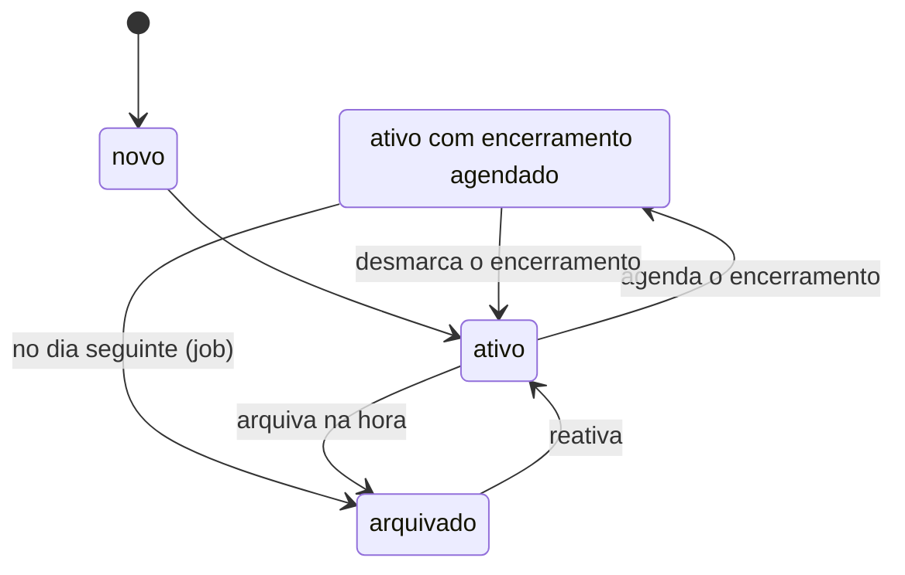
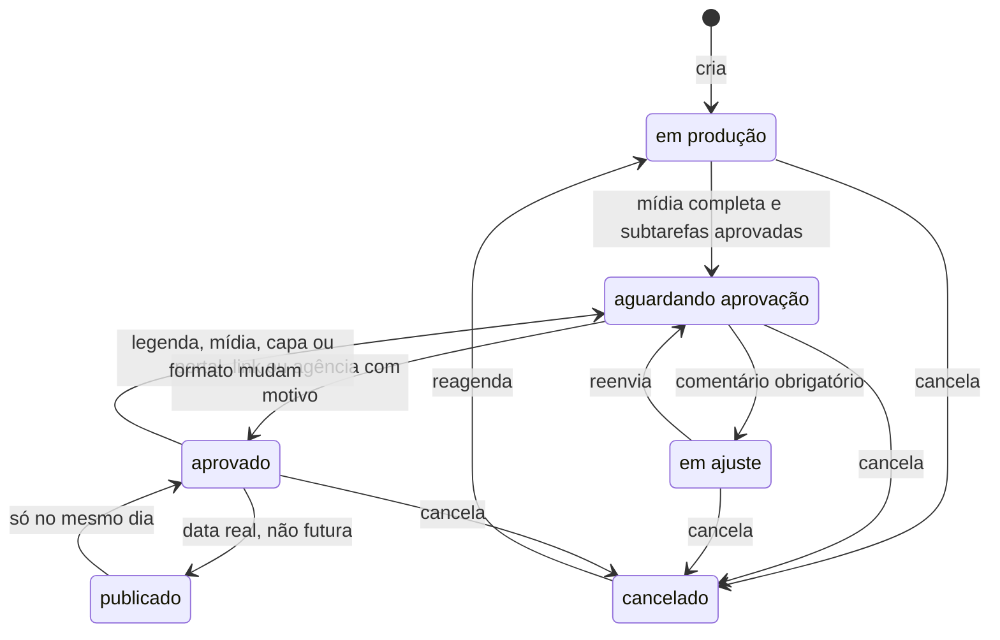
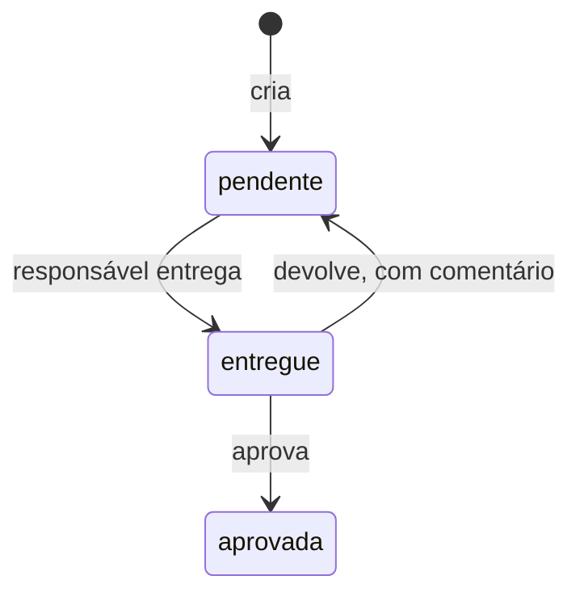
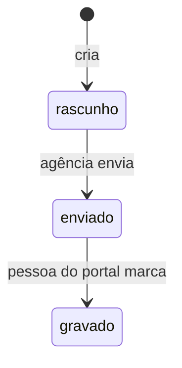
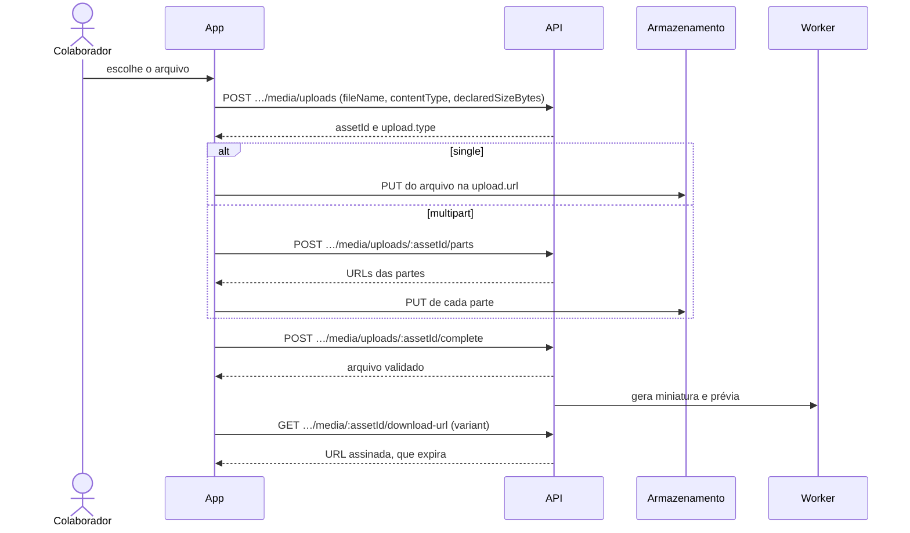
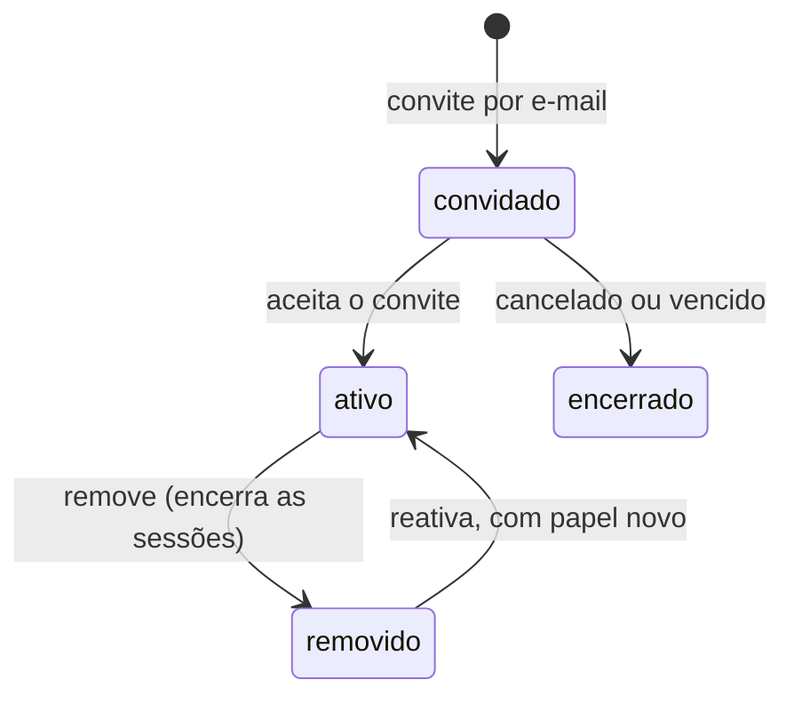

# Agência

A equipe da agência, no contexto `agency`. Todas as rotas começam com `/agencies/:agencyId`; nas tabelas, `…` substitui esse prefixo. Corpo, resposta e erros de cada rota estão na [referência da API](../../api/README.md).

## Antes de tudo: permissões, papéis e plano

1. Ao entrar na agência, chame `GET …/me`. Ele devolve as **permissões efetivas** da pessoa e o **plano**: `kind` (`trial`, `ativo` ou `isenta`), `trialEndsAt` e `readOnly`.
2. Mostre ou esconda as ações pela permissão. Quem não tem a permissão recebe `403 FORBIDDEN` do backend de qualquer jeito.

| método | rota | permissão | o que faz |
|---|---|---|---|
| `GET` | `…/me` | vínculo com a agência | permissões efetivas e plano do contexto |

**Quem pode o quê** (papéis de sistema; a agência ainda não cria papéis próprios pelo produto):

| área | Admin | Gestor de conta | Produção | Vendas | Financeiro |
|---|:-:|:-:|:-:|:-:|:-:|
| ver clientes, estudo de marca e conversas | ✅ | ✅ | ✅ | ✅ | ✅ |
| editar cliente, estudo e personas; responder e resolver conversa | ✅ | ✅ | | | |
| cadastrar cliente | ✅ | ✅ | | | |
| agendar encerramento, arquivar e reativar cliente | ✅ | | | | |
| gerir as pessoas do portal | ✅ | | | | |
| ver conteúdos, calendário, pastas e roteiros | ✅ | ✅ | ✅ | | |
| criar e editar conteúdo, mídia, subtarefas e roteiros; enviar para aprovação; publicar | ✅ | ✅ | ✅ | | |
| aprovar fora da plataforma; cancelar conteúdo | ✅ | ✅ | | | |
| ver a equipe | ✅ | ✅ | ✅ | ✅ | ✅ |
| editar o cargo de outra pessoa | ✅ | ✅ | | | |
| convidar, remover, reativar e trocar papel | ✅ | | | | |

- O **Owner** não é um papel: é quem criou a agência, e ele passa em tudo. **Só o Owner gerencia a assinatura**, e só ele concede o papel Admin.
- **Cargo não é papel.** O cargo (`jobTitle`) descreve o trabalho e não dá acesso.
- Vendas e Financeiro **não veem conteúdo**, nem os indicadores que vêm dele (nem as abas Conteúdos e Mídias do cliente, nem "quem trabalha neste cliente").

> **Estado de 2026-11-11 (redesenho).** Este documento descreve o produto **depois** das decisões do redesenho (todas pendentes de validação do dono, em `docs/business/decisions/2026-11-11-*`). Onde um item diz "proposta", a rota ou o campo ainda não existe e o nome é o que a SPEC propõe; o texto e as regras valem, o nome pode mudar na implementação.

**Teste grátis e modo leitura**

- A agência nasce em teste de **14 dias**, com até **3 clientes**, **3 colaboradores** e **2 GB**. O Owner e os convites pendentes contam como colaboradores.
- A agência fica **somente leitura** ao fim do teste sem assinatura ou ao fim do período de uma assinatura cancelada:
  - tudo continua visível e nada é apagado;
  - a escrita é recusada com `409 AGENCY_READ_ONLY`;
  - continuam liberados remover colaborador, remover acesso ao portal e cancelar convite;
  - mostre um aviso no topo de que o plano precisa ser renovado.
- Erros ao estourar um limite:
  - `409 TRIAL_CLIENT_LIMIT`, `409 PLAN_CLIENT_LIMIT` e `409 TRIAL_COLLABORATOR_LIMIT`;
  - `409 QUOTA_EXCEEDED` para armazenamento;
  - `429 DAILY_EMAIL_LIMIT` nos convites: 20 e-mails por dia no teste e 200 nos planos.

**Listas.** São paginadas, com `pageSize` de no máximo 100. Itens arquivados só aparecem quando pedidos.

## Listas vazias, boas notícias e falhas

Uma lista ou painel sem itens diz uma de três coisas diferentes (decisão de 2026-11-10, [três tipos de estado vazio](../../business/decisions/2026-11-10-tres-tipos-de-estado-vazio.md)). O primeiro uso é só texto e ação, sem ícone; a boa notícia e a falha levam ícone e texto, nunca só cor. Enquanto "Tentar de novo" repete a consulta, o botão fica ocupado e não aceita outro clique.

| tipo | quando | o que mostra |
|---|---|---|
| **Primeiro uso** | a agência ainda não criou aquilo | convida à ação, com o botão que cria, se a pessoa tem a permissão (por exemplo "Nenhum cliente ativo ainda" com "Cadastrar cliente"); sem a permissão, só o texto |
| **Boa notícia** | a consulta respondeu e não há nada pendente (por exemplo "Nenhum convite aguardando aceite" numa equipe que já tem gente) | diz que nada está esperando, com o visto |
| **Falha** | a consulta não respondeu | mostra o **mascote sério** (desde 2026-11-11, na agência e no portal), diz que não foi possível carregar, com "Tentar de novo", que repete a consulta, e, quando a agência tem contato de suporte, "Avisar o suporte" (abre um e-mail pronto; sem contato configurado, o botão não existe) e o código do erro ("Código 503 · 11 nov, 10h42") |

- **Regra.** A tela só afirma que não há nada pendente quando a consulta **respondeu** e a tela **cobre todos os estados pendentes**. Consulta que falhou é sempre falha: nunca "nenhum", nunca boa notícia.
- Resultado de busca ou de filtro sem itens ("Nenhum cliente encontrado para …") não é nenhum dos três: é só o texto e "Limpar busca" ou "Limpar filtros".

## Barra superior: busca, notificações e Ajuda

Decisões de 2026-11-11: [busca](../../business/decisions/2026-11-11-busca-na-agencia-e-no-portal.md), [notificações](../../business/decisions/2026-11-11-estrutural-notificacoes-so-dentro-do-app-com-cinco-eventos.md) e [Ajuda](../../business/decisions/2026-11-11-ajuda-e-um-menu-com-rever-o-tour-e-o-status-do-sistema.md). SPECs: `specs/busca.md` e `specs/notificacoes.md`.

**Busca** (Ctrl K em qualquer tela da agência; no celular, o ícone da barra)

| método | rota | permissão | o que faz |
|---|---|---|---|
| `GET` | `…/search?q=` | vínculo com a agência; cada grupo pela permissão da leitura que ele atalha | `{ data: { clients, contents, files } }`, com os três grupos sempre presentes (*proposta*) |

1. `q` de 2 a 80 caracteres (menos que isso, não chame a API); espere 250 ms depois da última tecla e cancele a chamada anterior. `400 VALIDATION_ERROR` para termo curto, longo ou com caractere de controle; `429 RATE_LIMITED` (proposta: 60 por minuto), e a tela diz para esperar um instante.
2. Grupos: **Clientes** (`cliente.visualizar`: nome, razão social e @, sem acento nem diferenciar maiúsculas), **Conteúdos** (`conteudo.visualizar`: título) e **Arquivos** (`conteudo.visualizar`: nome do arquivo). No máximo 6 por grupo, por proximidade do começo do nome e depois ordem alfabética.
3. Quem não tem a permissão de um grupo recebe `[]` nele, **igual a quem tem e não achou nada**: nunca mostre "sem permissão". Vendas e Financeiro só têm Clientes.
4. Cliente arquivado e conteúdo cancelado aparecem, marcados. Arquivo removido e não confirmado não aparecem. O termo não vai para log nem para métrica.
5. Um resultado leva ao destino: cliente à Visão geral, conteúdo ao calendário do cliente com o conteúdo aberto, arquivo à aba Mídias, na pasta dele. Esc fecha, setas movem, Enter abre, e o foco volta ao campo que abriu.
6. **No portal** não há rota: o campo "Buscar um post" filtra, no aparelho, pelo título, os posts do mês que a tela de Conteúdos já carregou. De outra tela, digitar leva a Conteúdos com `?busca=`.

**Notificações** (o sino com ponto, só na agência)

| método | rota | permissão | o que faz |
|---|---|---|---|
| `GET` | `…/notifications` | a própria pessoa | lista paginada (20), da mais recente à mais antiga; `unread=true` filtra as não lidas |
| `GET` | `…/notifications/unread-count` | a própria pessoa | `{ data: { count } }`, para o ponto do sino |
| `POST` | `…/notifications/:notificationId/read` | a própria pessoa | `204`; a de outra pessoa é `404` |
| `POST` | `…/notifications/read-all` | a própria pessoa | `204`; marca as dela nessa agência |

- **Cinco eventos**: o cliente aprovou (com ou sem recado), o cliente pediu ajuste, o cliente respondeu um pedido de material (comentário ou arquivo), venceu o prazo de aprovação de um conteúdo que ainda aguarda, e um convite foi aceito (de colaborador ou do portal).
- **Quem recebe**: o responsável do conteúdo (os quatro primeiros eventos; no pedido de material, quem abriu o pedido) e quem enviou o convite. Só recebe quem **ainda pode ler** aquilo: sem `conteudo.visualizar`, o título do conteúdo não aparece, e a notificação some.
- Cada notificação é da pessoa: lê-se ao abrir (e ela leva ao conteúdo, ao pedido ou à equipe) ou em "Marcar todas como lidas". Não se apaga e não há preferência por tipo. **Não há e-mail novo, push nem WhatsApp**, e o portal não tem notificações. A lista só mostra um trecho curto, nunca o recado inteiro.
- **"Reenviar o link", "Cobrar o cliente" e o aviso de WhatsApp só compartilham** o endereço de entrada do portal, com uma mensagem pronta: nada é enviado pelo produto, e a tela nunca diz que o cliente "recebe no WhatsApp".

**Ajuda** (o `?` ao lado da busca)

Um menu com duas ações: **"Rever o tour"** (que antes ficava no menu de conta, e agora fica só aqui, na agência e no portal) e **"Status do sistema"** (a página pública `/status`). Não há central de ajuda, artigo nem chat. "Avisar o suporte" não é item do menu: só existe na tela de falha (acima) e abre um `mailto:` com o código do erro e o horário no corpo; o endereço é o `plan.supportContactEmail` que o servidor já devolve, e sem ele a ação não aparece. O menu de conta fica com o nome, "Conta" (a página com as sessões) e "Sair".

## Início: a jornada "Até a primeira aprovação" e os marcos

O Início da agência (decisão de 2026-11-11, [Aprovados no mês, Agendados e a jornada com data e nome](../../business/decisions/2026-11-11-o-inicio-da-agencia-mostra-aprovados-no-mes-agendados-e-passos-com-data-e-nome.md)) abre com a data de hoje (a sobrelinha), "Bom dia, <nome>" e o botão **"Novo conteúdo"** (abre o novo conteúdo do cliente, ou pede o cliente); **não há mais atalhos de módulo nem o bloco "Você pode adiantar"**: a pessoa chega aos módulos pela navegação. Quem vê conteúdos vê os blocos abaixo, e quem vê clientes e conteúdos vê também a jornada.

| bloco | o que conta | ação |
|---|---|---|
| **Esperando** | conteúdos aguardando a decisão do cliente | "Ver quem está parado" (leva a "Parado no cliente") |
| **Atrasados** | conteúdos **aguardando o cliente** cuja **data de publicação passou** ("a data passou sem aprovação"); o prazo de aprovação vencido não é "Atrasado" | "Cobrar o cliente" (só compartilha o endereço do portal) |
| **Aprovados no mês** | aprovados no mês corrente (aprovados ou publicados, pelo dia da aprovação em São Paulo, inclusive a aprovação fora da plataforma), comparados com o mês anterior ("3 a mais que em outubro", "3 a menos", "igual"; é a contagem de hoje de cada mês, **não um histórico**) | "Agendar os aprovados" (calendário filtrado em Aprovado, os que ainda estão sem hora) |
| **Agendados** | aprovados com data **e hora** de publicação futuras ("programados até dia 20"; **nunca** "saem sozinhos", porque a plataforma não publica sozinha) | "Abrir o calendário" |

Os números vêm de uma leitura de resumo do conteúdo (`GET …/contents/overview`, *proposta*, `conteudo.visualizar`), sem tabela nova. Sem `conteudo.visualizar`, os blocos não aparecem.

Para quem vê clientes e conteúdos, o Início mostra a jornada "Até a primeira aprovação" até a agência ter a primeira aprovação de um cliente (decisões de 2026-11-06 e de [2026-11-10](../../business/decisions/2026-11-10-jornada-ate-a-primeira-aprovacao.md), que só trocou a apresentação). Nada é guardado: o progresso vem de duas leituras.

| método | rota | permissão | o que faz |
|---|---|---|---|
| `GET` | `…/clients?page=1&pageSize=1` | `cliente.visualizar` | `meta.totalItems` diz se há cliente; o primeiro `id` leva aos passos 2 a 4 |
| `GET` | `…/contents/activation` | `conteudo.visualizar` | `hasContent`, `sentForApproval`, `approvedByClient` e `published`, e, desde 2026-11-11, **a data e o nome de cada passo feito** (*proposta*: o primeiro cliente, o primeiro conteúdo, o primeiro envio e a primeira aprovação) |

1. **Apresentação.** É uma jornada, não uma lista de tarefas: o título "Até a primeira aprovação", o progresso ("N de 4 concluídos", com a barra), os passos em ordem e o primeiro ainda pendente marcado como o atual. Cada passo diz quem o faz: "Você" nos três primeiros e **"Seu cliente"** no último. Cada passo leva a palavra "feito" ou "pendente", além do ícone. Não há incentivo por concluir a jornada.
2. Passos: cadastrar o primeiro cliente (`cliente.cadastrar`, vai a Clientes); criar o primeiro conteúdo (`conteudo.operar`, vai ao calendário do cliente); enviar para aprovação (`conteudo.operar`, mesmo destino); e o último, que é do cliente, "Seu cliente aprova pelo link, sem criar conta" (o botão "Convidar o cliente" exige `cliente.convidar_usuario` e vai aos acessos do portal do cliente). Sem a permissão do passo, ele aparece sem botão; com o plano em `readOnly`, nenhum botão de escrita.
2a. **Cada passo feito mostra "Feito", o nome e a data** (2026-11-11): o primeiro cliente ("Padaria Central · 3 de novembro"); o primeiro conteúdo; o primeiro envio ("Enviado a Rosana Teixeira · 9 de novembro", com o nome da pessoa ativa do portal do cliente, a primeira e "e mais N"; sem pessoa conhecida, o nome do cliente); e a primeira aprovação ("Aprovado por Rosana Teixeira · agora", com o nome de quem aprovou). A data é o dia de São Paulo, ou "agora" para o que aconteceu há menos de uma hora; os "Marcos da agência" mostram as mesmas datas e nomes. O nome da pessoa do portal só vem a quem tem `cliente.convidar_usuario`; sem essa permissão, o passo mostra o nome do cliente. O passo 4 ("Seu cliente aprova pelo link, sem criar conta") tem "Enviar link de aprovação" e "Copiar link", que **só compartilham** o endereço de entrada do portal: não geram token nem enviam nada.
3. Feito = cliente existe (ou há conteúdo); há conteúdo; algum saiu da produção; algum foi aprovado por pessoa do cliente (a aprovação fora da plataforma não conta). O último passo só está feito quando o cliente aprova. Com os quatro feitos, a jornada some. Se uma das duas leituras falha, a jornada não aparece e o Início fica como era.
4. Marcos celebrados uma vez por agência (cliente, conteúdo, enviado, primeira aprovação, primeiro `published`): mensagem em português, confete que não bloqueia toque e some sozinho, sem confete se o aparelho pede menos movimento. O que já foi celebrado fica só no aparelho (no navegador, `localStorage`); a primeira abertura apenas registra o que já existe, sem celebrar.

### Parado no cliente

O Início também mostra o que está esperando a decisão do cliente (decisão de 2026-11-10), agrupado por cliente.

| método | rota | permissão | o que faz |
|---|---|---|---|
| `GET` | `…/contents/awaiting-client` | `conteudo.visualizar` | os conteúdos em "aguardando aprovação", agrupados por cliente, até 50 ao todo |

1. Sem corpo nem parâmetro. A resposta é `data` (uma lista de `{ clientId, clientName, contents }`) e `meta.truncated`, verdadeiro quando havia mais de 50 e a lista foi cortada. Cada conteúdo traz `id`, `title`, `format`, `publishOn`, `sentAt`, `dueOn` (desde 2026-11-11, **o instante** do prazo, com hora, como `dueAt`: ver "Rodada de aprovação"), `daysWaiting` e `daysToDue`, e o cabeçalho do cliente traz **quem aprova** (o nome da pessoa ativa do portal; com mais de uma, a primeira e "e mais N"; *proposta*, só para quem tem `cliente.convidar_usuario`).
2. **Ordem (2026-11-11, [Atrasado e a ordem de "Parado no cliente"](../../business/decisions/2026-11-11-atrasado-conta-pela-data-de-publicacao-e-parado-no-cliente-segue-a-ordem-de-envio.md)):** do conteúdo **enviado há mais tempo** para o mais novo (`sentAt`); o sem data de envio (anterior às rodadas) vai por último, pela data de publicação. Os clientes seguem a ordem do primeiro conteúdo de cada um. O corte dos 50 tira o mais novo. O prazo de aprovação **não ordena** mais a lista.
3. A linha mostra a capa, o formato e "deveria ter saído em <data>" quando a data de publicação passou, ou "enviado há N dias"; as etiquetas são "Atrasado N dias" e "Aguardando aprovação". O estado do prazo é contado pelo servidor; o aplicativo só escreve o texto: com hora, "vence hoje às 18h"; senão, `daysToDue` positivo é "vence em N dias", `1` é "vence amanhã", `0` é "vence hoje" e negativo é "venceu há N dias". O prazo vencido não é "Atrasado": **"Atrasado" é a data de publicação que passou**, em qualquer estado aberto, e o prazo de aprovação vencido é "venceu há N dias" (e gera a notificação "venceu o prazo"). "Reenviar o link" no cabeçalho do cliente só compartilha o endereço do portal.
4. Sem prazo, o item mostra há quantos dias foi enviado (`daysWaiting`, desde `sentAt`). O conteúdo que já aguardava antes das rodadas vem sem `sentAt`, `dueOn` e contagens (todos `null`) e aparece sem esse dado, por último.
5. Quem vê: a mesma regra do calendário. Sem `conteudo.visualizar` a resposta é `403`; o que a pessoa não pode ler não entra. Cliente arquivado não entra. Não há paginação.

## Clientes

| método | rota | permissão | o que faz |
|---|---|---|---|
| `GET` | `…/clients` | `cliente.visualizar` | carteira na ordem de triagem |
| `POST` | `…/clients` | `cliente.cadastrar` | cadastra (só o nome é obrigatório) |
| `GET` | `…/clients/:clientId` | `cliente.visualizar` | detalhe com o resumo da Visão geral, a cidade, `createdAt` e as contagens das abas |
| `PATCH` | `…/clients/:clientId` | `cliente.operar` | edita o cadastro |
| `PUT` | `…/clients/:clientId/photo` | `cliente.operar` | envia a foto |
| `DELETE` | `…/clients/:clientId/photo` | `cliente.operar` | remove a foto |
| `PUT` | `…/clients/:clientId/closing` | `cliente.arquivar` | agenda o encerramento |
| `DELETE` | `…/clients/:clientId/closing` | `cliente.arquivar` | desmarca o encerramento |
| `POST` | `…/clients/:clientId/archive` | `cliente.arquivar` | arquiva agora |
| `POST` | `…/clients/:clientId/reactivate` | `cliente.arquivar` | reativa |

**Ciclo do cliente**

- Com o encerramento agendado, tudo funciona até o fim da data, inclusive o portal. No dia seguinte, um job arquiva o cliente.
- **Arquivar:**
  - o portal fica inacessível na hora;
  - os convites de portal pendentes são revogados;
  - os conteúdos com data depois do encerramento viram cancelados e não voltam sozinhos;
  - os acessos são preservados: reativar devolve o portal a quem tinha.
- **Cliente arquivado é só leitura.** A única ação é reativar; as demais recebem `409 CLIENT_ARCHIVED`.
- Dois clientes ativos não podem ter o mesmo nome, sem diferenciar maiúsculas. Reativar um cliente cujo nome já está em uso é recusado.
- Todo colaborador vê todos os clientes. Não há atribuição de cliente a pessoa.

**O perfil do cliente na web (2026-11-11)**, decisões [cinco abas](../../business/decisions/2026-11-11-o-perfil-do-cliente-tem-cinco-abas-e-a-aba-conteudos-volta.md) e [cidade](../../business/decisions/2026-11-11-estrutural-o-cliente-ganha-cidade-e-quem-trabalha-nele-e-derivado.md):

- **Cinco abas, nesta ordem, cada uma com a contagem:** Visão geral (antes "Geral"), **Conteúdos** (os não cancelados do mês), **Mídias** (os arquivos), **Marca** (antes "Estudo de marca") e **Acessos** (as pessoas ativas no portal). A contagem só vem para quem tem a permissão da aba: `conteudo.visualizar` em Conteúdos e Mídias, `cliente.convidar_usuario` em Acessos; **sem a permissão o campo é omitido, não zero**. **Tarefas e Relatórios não existem mais** (os endereços respondem "não encontrado"); voltam com o módulo.
- **Conteúdos** é a lista dos conteúdos do cliente **agrupada por quem precisa agir** (Esperando o cliente, Atrasado, Em produção, Aprovado e agendado; ou por data, ou por formato), com a capa, o formato, a data, quem cuida e o estado, e os botões "Nova publicação" e "Abrir no Calendário Editorial". Usa `GET …/clients/:clientId/contents` por período; o calendário continua com um endereço só.
- **Cabeçalho:** trilha "Clientes > nome", o estado, o @, a **cidade**, o segmento e "cliente desde <mês e ano>" (a data de criação do cadastro, `createdAt`). "Quem trabalha neste cliente" são os avatares dos **responsáveis dos conteúdos abertos** do cliente, do que tem mais conteúdos ao que tem menos, com "+N": é **derivado**, sem atribuição de cliente a pessoa, e só aparece para quem tem `conteudo.visualizar`.
- **Visão geral:** quatro blocos (Estudo de marca "5 de 7", Conversas, Portal, Mídias "171 arquivos em 5 pastas"), os **pedidos de material** com "Pedir material", e o Cadastro com o seu "Editar". Não há "Atividade" nem espaço reservado para "saúde do cliente".
- **Cidade:** campo opcional de até 80 caracteres, editado no cadastro (`PATCH …/clients/:clientId`), visível ao portal, como o resto do cadastro do próprio cliente.

## Estudo de marca e personas

| método | rota | permissão | o que faz |
|---|---|---|---|
| `GET` | `…/clients/:clientId/brand-study` | `cliente.visualizar` | as sete seções e as personas |
| `PUT` | `…/clients/:clientId/brand-study/sections/:sectionKey` | `cliente.operar` | grava uma seção |
| `POST` | `…/clients/:clientId/personas` | `cliente.operar` | cria uma persona |
| `PATCH` | `…/clients/:clientId/personas/:personaId` | `cliente.operar` | edita uma persona |
| `POST` | `…/clients/:clientId/personas/:personaId/archive` | `cliente.operar` | arquiva (some do portal) |
| `POST` | `…/clients/:clientId/personas/:personaId/unarchive` | `cliente.operar` | desarquiva |

**Persona (2026-11-11, [campos novos](../../business/decisions/2026-11-11-estrutural-a-persona-ganha-idade-ocupacao-local-tracos-onde-esta-e-tom.md)).** Além de nome, descrição, dores, desejos e objeções, a persona ganha, todos opcionais: **idade** (1 a 120), **ocupação** (até 80), **local** (até 80), **traços** (até 5 chips de até 24 caracteres), **"onde está"** (até 280) e **"tom que funciona"** (até 280). Persona sem eles continua válida. O perfil mostra a linha de apoio "34 anos · gerente de RH · Pinheiros", os chips e as linhas Dor, Desejo, Objeções, Onde está e Tom que funciona, **cada uma com o seu lápis, salvando sozinha** no mesmo `PATCH …/personas/:personaId`. O formulário avisa para não pôr dado de pessoa real. O portal lê os campos novos junto da persona ativa.

### Navegação do estudo de marca na web

A aba do cliente mostra uma seção por vez, com um índice das sete seções ao lado (uma faixa que rola na horizontal no celular). Só a apresentação mudou: as rotas, as permissões, as mensagens e o que cada seção grava são os de sempre.

- **Índice.** Cada item diz se a seção está preenchida e quantas conversas dela aguardam a agência. O cabeçalho mantém "N de 7 preenchidas", que vem do campo `filled` da resposta do estudo; "preenchida" de cada item o app calcula com a mesma regra do servidor (texto sem contar espaços, ao menos uma cor, um arquétipo, ao menos uma persona ativa), porque a API devolve só o total.
- **"N aguardando".** A API não devolve esse total. O app lê `GET …/threads?sectionKey=<seção>&state=open` (e `personaId=<id>` para cada persona ativa) e conta as conversas abertas cujo último comentário não é da agência, a mesma regra de "aguardando você" da coluna de conversas. Item sem nada aguardando não mostra número.
- **Personas.** O número do item Personas soma a conversa da própria seção e as conversas das personas **ativas**; as arquivadas não entram. Cada cartão de persona traz o próprio "N aguardando", com a conversa daquela persona.
- **Seção aberta.** É um cartão com o título, "editado por … · data" e o botão Editar. As conversas da seção ficam numa coluna própria ao lado (abaixo do cartão em telas estreitas), com "Nova conversa". Seção vazia mostra o estado vazio de primeiro uso, com o botão de preencher.
- **Personas.** Um cartão por persona (iniciais, nome, descrição curta) e "Nova persona". Abrir uma persona mostra o perfil, com Dores, Desejos e Objeções, Editar, Arquivar (com a mesma confirmação) e as conversas dela; as conversas de uma persona arquivada continuam visíveis. Há um caminho de volta para a lista.
- **Endereço.** A seção e a persona abertas ficam na URL: `?secao=<seção>` e `?persona=<id>`.

| `secao` | seção |
|---|---|
| `branding` | Branding |
| `tom-de-voz` | Tom de voz |
| `cores` | Cores |
| `posicionamento` | Posicionamento |
| `arquetipo` | Arquétipo |
| `personas` | Personas |
| `observacoes` | Observações |

- Sem `secao` abre a primeira seção (Branding). Um `secao` desconhecido cai na primeira seção, sem erro. `persona` sozinho abre o perfil dessa persona. Um `persona` que não existe é ignorado: com `secao=personas` mostra a lista, sem `secao` abre a primeira seção. `persona` junto de outra `secao` que não seja `personas` também é ignorado: abre a seção pedida.
- Quem está editando uma persona e sai do perfil (pelo índice, por "Voltar para Personas" ou pelo voltar do navegador) não perde o texto: ao reabrir a persona, o formulário volta com o que foi digitado, como nas outras seções. Só Cancelar ou Salvar o descarta.
- Cliente arquivado e plano em modo leitura continuam só leitura; sem `cliente.operar` os botões de edição não aparecem.

## Conversas com o cliente

| método | rota | permissão | o que faz |
|---|---|---|---|
| `GET` | `…/clients/:clientId/threads` | `cliente.visualizar` ou `conteudo.visualizar` | conversas de um assunto |
| `POST` | `…/clients/:clientId/threads` | `cliente.operar` ou `conteudo.operar` | abre uma conversa com o primeiro comentário |
| `GET` | `…/clients/:clientId/threads/:threadId/comments` | `cliente.visualizar` ou `conteudo.visualizar` | comentários |
| `POST` | `…/clients/:clientId/threads/:threadId/comments` | `cliente.operar` ou `conteudo.operar` | comenta |
| `POST` | `…/clients/:clientId/threads/:threadId/resolve` | `cliente.operar` ou `conteudo.operar` | resolve |

- **Não existe conversa interna.** A agência pode comentar em produção; o cliente vê a conversa quando o conteúdo é disponibilizado no portal. Conteúdo cancelado não aceita comentários.
- O estado da conversa é calculado, não gravado:
  - ela está **resolvida** se foi resolvida depois do último comentário;
  - qualquer comentário novo a **reabre**, então não existe ação de "reabrir";
  - "aguardando a agência" é a conversa aberta cujo último comentário é do cliente.
- Comentário não se edita nem se apaga. Só a agência resolve conversas.

### Pedido de material

A agência pede material ao cliente (por exemplo, "envie 3 fotos da equipe") e acompanha se ele respondeu. É um assunto da conversa **do próprio cliente**, ao lado da seção da marca, da persona e do conteúdo. Não existe dentro da conversa de um conteúdo, então o portal continua sem ver a conversa de um conteúdo em produção. Decisão: [pedido de material](../../business/decisions/2026-11-10-estrutural-pedido-de-material-e-assunto-proprio-da-conversa-do-cliente.md).

0. **Título (2026-11-11, [decisão](../../business/decisions/2026-11-11-estrutural-o-pedido-de-material-ganha-titulo.md)).** Todo pedido novo tem `title` (obrigatório, até 80 caracteres) além do texto (`body`). O pedido anterior fica sem título, e a tela usa o começo do texto. O prazo continua um dia, e ganha estado: "atrasado" quando o dia passou e o pedido não foi resolvido. As etiquetas são derivadas da conversa: **aberta** (a agência pediu e o cliente não respondeu), **aguardando você** (o último comentário é do cliente) e **resolvida**; "Aberta por <nome> (agência)" usa quem abriu.
1. **Abrir.** `POST …/clients/:clientId/threads` com `{ "subject": { "materialRequest": true }, "title": "Depoimentos em vídeo", "body": "Envie 3 fotos da equipe", "dueOn": "2026-11-20" }`. Pede `cliente.operar`. Cada chamada abre um pedido novo. Não há rota própria de abertura.
2. **Prazo opcional.** `dueOn` é uma data `AAAA-MM-DD`, de hoje a 90 dias, no fuso de São Paulo. Fora disso é `400` com o campo `dueOn`. `dueOn` com qualquer outro assunto também é `400`.
3. **Listar.** `GET …/clients/:clientId/threads?materialRequest=true` traz os pedidos do cliente, em qualquer estado. O assunto vem como `subject: { materialRequest: true }` e o prazo como `dueOn` (`null` se não houver). Pede `cliente.visualizar`. Toda conversa passou a trazer `dueOn`, que é `null` fora do pedido.
4. **Acompanhar.** O cliente responde **por comentário ou por arquivo** (fotos e áudio enviados pelo portal, ver "Mídias"), e a agência comenta pela rota de sempre (`…/threads/:threadId/comments`). O arquivo aparece no pedido (Visão geral e aba Mídias, na pasta "Enviados pelo cliente", com "Enviada por <nome do cliente>"). Cada resposta gera a notificação "o cliente respondeu um pedido de material".
5. **Resolver.** `POST …/threads/:threadId/resolve`, a mesma rota das outras conversas. Resolvido, o pedido sai do Início do portal. Um comentário novo do cliente o reabre, como em toda conversa.

- Só a agência abre e resolve um pedido. O portal não consegue abrir um (`400`).
- O pedido **não conta** em "aguardando a agência" nem em "com resposta da agência": esses números são das conversas do estudo de marca.

## Pessoas do portal do cliente

| método | rota | permissão | o que faz |
|---|---|---|---|
| `GET` | `…/clients/:clientId/members` | `cliente.convidar_usuario` | quem tem acesso |
| `POST` | `…/clients/:clientId/members` | `cliente.convidar_usuario` | adiciona uma pessoa (manda o e-mail de boas-vindas); aceita o `name` opcional digitado pela agência |
| `POST` | `…/clients/:clientId/members/:accessId/resend` | `cliente.convidar_usuario` | reenvia o e-mail a quem ainda não entrou |
| `POST` | `…/clients/:clientId/members/:accessId/remove` | `cliente.remover_usuario` | remove (encerra as sessões da pessoa) |
| `POST` | `…/clients/:clientId/members/:accessId/reactivate` | `cliente.remover_usuario` | reativa, sem convite |
| `GET` | `…/clients/:clientId/invitations` | `cliente.convidar_usuario` | convites antigos ainda pendentes |
| `POST` | `…/clients/:clientId/invitations/:invitationId/resend` | `cliente.convidar_usuario` | transforma um convite antigo em acesso |

- A pessoa do portal não tem papel. Todas as pessoas de um cliente podem as mesmas coisas.
- **Nome antes da entrada (2026-11-11, [decisão](../../business/decisions/2026-11-11-estrutural-o-nome-do-convidado-digitado-pela-agencia-aparece-antes-da-entrada.md)).** O modal "Adicionar pessoa" tem o campo **Nome**, opcional. O nome digitado é o que a lista e a mensagem de WhatsApp mostram **enquanto a pessoa não entrou**; depois da entrada vale o nome da conta, e a ordem da lista usa a mesma expressão. Ele vem só do que a agência escreveu, **nunca da conta com aquele e-mail**: a lista e a resposta continuam iguais para e-mail com e sem conta. Sem nome, a linha mostra o e-mail.
- **Último acesso.** Cada pessoa da lista traz `lastEnteredAt`, o último acesso àquele cliente (a última entrada no portal com a conta ou a última vez que abriu o link de aprovação do e-mail), ou `null`. Só quem já lê esta lista o recebe. Decisão: [último acesso ao portal](../../business/decisions/2026-11-10-estrutural-ultimo-acesso-ao-portal-por-cliente.md).
- **Quatro casos para mostrar na lista.** A data e a hora são sempre as de São Paulo (um instante às 01:30 UTC ainda é a noite do dia anterior), no formato da web: dia e mês com dois dígitos, ano com quatro e hora de 24 horas.
  - `entered: true` e `lastEnteredAt` preenchido: entrou com a conta. Mostre o nome e "Último acesso <dd/mm/aaaa> às <hh:mm>", por exemplo "Último acesso 10/10/2026 às 22:30".
  - `entered: true` e `lastEnteredAt: null`: entrou com a conta, mas não há data gravada. Mostre "Já entrou com a conta".
  - `entered: false` e `lastEnteredAt` preenchido: só abriu o link de aprovação. Mostre "Ainda não entrou com a conta · abriu o link em <dd/mm/aaaa>", sem hora e sem as palavras "Último acesso".
  - `entered: false` e `lastEnteredAt: null`: "Nunca entrou".
- **Compartilhar o acesso.** Cada pessoa ativa da lista tem "Copiar link" e "Enviar pelo WhatsApp" (decisão de [2026-11-10](../../business/decisions/2026-11-10-compartilhar-o-acesso-ao-portal-por-link-e-whatsapp.md)). Os dois compartilham o endereço de entrada do portal (`/entrar`), que **não tem token e não dá acesso sozinho**: a pessoa ainda entra pelo próprio e-mail. Nenhum dos dois chama a API.
  - A mensagem pronta fala em nome da agência e é a mesma para os dois: "Olá, <primeiro nome>! Aqui é <agência>. Este é o seu acesso ao portal de aprovação de <cliente>, onde você aprova os conteúdos. Entre com o seu e-mail: <endereço>". Não há artigo antes dos nomes ("Aqui é Agência Um", "aprovação de Padaria Central"). Quem nunca entrou e não tem nome digitado não tem nome para cumprimentar: a mensagem começa em "Olá!"; com o nome digitado pela agência, começa em "Olá, Débora!".
  - "Copiar link" confirma na linha da pessoa com "Link copiado"; se a cópia for recusada, diz "Não foi possível copiar. O endereço de entrada é <endereço>". "Enviar pelo WhatsApp" abre o WhatsApp em outra aba com a mesma mensagem.
  - Só para quem tem a permissão da aba (`cliente.convidar_usuario`); continuam disponíveis com o plano em somente leitura, porque nada é gravado. Não existem para pessoa removida nem para cliente arquivado.
- `entered` continua sendo "entrou com a conta" e é ele que libera **Reenviar boas-vindas**: quem só abriu o link ainda pode receber o e-mail de novo. Decisão: [quem só abriu o link ainda não entrou com a conta](../../business/decisions/2026-11-10-quem-so-abriu-o-link-de-aprovacao-ainda-nao-entrou-com-a-conta.md).
- Um colaborador da agência, mesmo o Owner, **não entra no portal** sem um acesso próprio àquele cliente.

## Conteúdos

| método | rota | permissão | o que faz |
|---|---|---|---|
| `GET` | `…/clients/:clientId/contents` | `conteudo.visualizar` | conteúdos e roteiros de um período (calendário e feed em tela cheia) |
| `GET` | `…/clients/:clientId/contents/feed?cursor=` | `conteudo.visualizar` | o feed inteiro do cliente (image, carousel e reels não cancelados), do mais recente ao mais antigo, 9 por página; os contadores só vêm na primeira página (`null` nas outras) e há limite de 300 leituras por minuto por pessoa (`429 RATE_LIMITED` com `Retry-After`) |
| `POST` | `…/clients/:clientId/contents` | `conteudo.operar` | cria, em produção. Sem `mediaAssetIds` no corpo, o conteúdo **herda a mídia da pasta** (a que serve ao formato); com a lista, vale a lista, e `[]` cria sem mídia |
| `GET` | `…/clients/:clientId/contents/:contentId` | `conteudo.visualizar` | detalhe com as mídias, as subtarefas e a conversa |
| `PATCH` | `…/clients/:clientId/contents/:contentId` | `conteudo.operar` | edita; mudar a data é editar `publishOn` |
| `POST` | `…/clients/:clientId/contents/:contentId/submit` | `conteudo.operar` | envia para aprovação (ou reenvia depois do ajuste), com prazo e recado opcionais: `{ dueAt?, note? }` (`dueAt` é o instante do prazo, desde 2026-11-11; a tela propõe 48 horas depois do envio) |
| `POST` | `…/clients/:clientId/contents/submit` | `conteudo.operar` | envia vários conteúdos do mesmo cliente de uma vez, com o mesmo prazo e recado: `{ contentIds, dueAt?, note? }` |
| `POST` | `…/clients/:clientId/contents/:contentId/approve-by-agency` | `conteudo.aprovar_pela_agencia` | registra uma aprovação feita fora da plataforma, com motivo |
| `POST` | `…/clients/:clientId/contents/:contentId/publish` | `conteudo.publicar` | marca como publicado |
| `POST` | `…/clients/:clientId/contents/:contentId/unpublish` | `conteudo.publicar` | desfaz a publicação, só no mesmo dia |
| `POST` | `…/clients/:clientId/contents/:contentId/cancel` | `conteudo.cancelar` | cancela (o conteúdo fica guardado) |
| `POST` | `…/clients/:clientId/contents/:contentId/reschedule` | `conteudo.operar` | reagenda um conteúdo cancelado |

Formatos: `image`, `carousel`, `reels`, `long_video` e `vsl`. Plataforma: `instagram`.

**Estados do conteúdo**

| de | para | quem | condição |
|---|---|---|---|
| em produção (`in_production`) | aguardando aprovação | `conteudo.operar` | mídia completa para o formato e todas as subtarefas aprovadas |
| aguardando aprovação (`awaiting_approval`) | aprovado | pessoa do portal, link de aprovação, ou `conteudo.aprovar_pela_agencia` com motivo | — |
| aguardando aprovação | em ajuste (`adjusting`) | pessoa do portal ou link de aprovação | comentário obrigatório |
| em ajuste | aguardando aprovação | `conteudo.operar` | reenviar |
| aprovado (`approved`) | publicado (`published`) | `conteudo.publicar` | data real, não futura |
| publicado | aprovado | `conteudo.publicar` | só no mesmo dia |
| qualquer um, menos publicado | cancelado (`cancelled`) | `conteudo.cancelar`, ou o arquivamento do cliente | — |
| cancelado | em produção | `conteudo.operar` | reagendar |
| aprovado | aguardando aprovação | automático | ao mudar a legenda, a mídia, a capa ou o formato |

**Rodada de aprovação: prazo e recado** (decisão de 2026-11-10)

- Cada envio abre uma **rodada**, guardada por conteúdo. O corpo do envio é opcional (`{}` continua valendo): `dueAt` é o prazo da decisão do cliente, **um instante** (data e hora, no fuso de São Paulo) de agora até 90 dias à frente ([decisão de 2026-11-11](../../business/decisions/2026-11-11-estrutural-o-prazo-de-aprovacao-tem-hora-e-padrao-de-48-horas.md); antes era só um dia, `dueOn`); `note` é o recado ao cliente, de 1 a 500 caracteres, sem só espaços. Sem prazo ou sem recado, a rodada vai sem ele. O **padrão de 48 horas** é da tela: o diálogo de envio propõe o prazo de 48 horas depois do envio, que a pessoa muda ou limpa; a API continua aceitando o envio sem prazo, e a rodada sem prazo continua existindo. O prazo que já estava gravado como dia vale até 23h59 daquele dia.
- Prazo fora da faixa é `400 CONTENT_APPROVAL_DUE_INVALID`; recado em branco, longo ou com caractere invisível é `400 VALIDATION_ERROR` (o banco ainda responde `400 CONTENT_APPROVAL_NOTE_INVALID` como segunda barreira). Cancelar e desfazer a publicação continuam sem corpo.
- **Envio em lote**: de 1 a 30 conteúdos do mesmo cliente, cada um uma vez, com o mesmo `dueOn` e `note`. É tudo ou nada: um conteúdo que não pode ser enviado recusa o lote inteiro com o código do envio individual (`409 CONTENT_STATE`, `CONTENT_MEDIA_INCOMPLETE`, `CONTENT_MEDIA_NOT_CONFIRMED` ou `CONTENT_TASKS_NOT_APPROVED`). Conteúdo de outro cliente, de outra agência ou inexistente é `404 NOT_FOUND`; mais de 30, repetido ou lista vazia é `400 VALIDATION_ERROR`. A resposta traz `batchId` e os conteúdos como a lista do calendário os traz, já em "aguardando aprovação".
- Reenviar depois do ajuste abre uma rodada nova, com o prazo e o recado do novo envio. Quando o cliente desfaz a aprovação, o conteúdo volta à **mesma rodada**, com o mesmo prazo e recado.
- Repetir o mesmo envio (o mesmo prazo e o mesmo recado) de um conteúdo que já aguarda não muda nada e não é erro; pedir outro prazo ou recado para quem já aguarda é `409 CONTENT_STATE`.
- O conteúdo e a lista do calendário trazem `approval`: `{ sentAt, dueAt, note }` da rodada enquanto o conteúdo aguarda aprovação, e `null` nos outros estados e no conteúdo que já aguardava antes das rodadas (sem data de envio e sem prazo; nada foi reescrito).
- O cliente é avisado por e-mail no envio, com o prazo e o recado assinados pela agência, e recebe dois lembretes: "vence amanhã", na véspera do prazo, e "venceu", no dia seguinte. Saem às 9h de São Paulo, uma vez por rodada cada um, só para as pessoas ativas do portal daquele cliente e só enquanto o conteúdo ainda aguarda decisão. Não sai nada para cliente arquivado, agência suspensa ou em somente leitura, e não sai "vence amanhã" quando o envio foi feito na própria véspera do prazo. Os lembretes contam o **dia** de São Paulo do prazo; a hora do prazo não cria lembrete novo. No Início e no portal o estado do prazo usa a hora ("vence hoje às 18h", "vence em 2 dias", "venceu há 1 dia").
- **Remetente e recado do cliente (2026-11-11, [decisão](../../business/decisions/2026-11-11-estrutural-a-rodada-de-aprovacao-mostra-ao-cliente-quem-enviou-e-aceita-recado-ao-aprovar.md)).** O portal passa a ver, da rodada, o **nome**, a **foto** e a **data de envio** de quem da agência enviou, ao lado do recado ("Recado de João Pereira, da Agência Horizonte"); não chegam ao portal o e-mail, o cargo, o papel nem o identificador do colaborador, e o lote continua sem chegar. Ao aprovar, a pessoa do portal pode dar um **recado opcional (até 500 caracteres)** à agência, que vira **comentário do cliente na conversa do conteúdo**, na mesma transação da aprovação; pedir ajuste continua exigindo comentário, e o link de aprovação do e-mail continua aprovando sem recado. O e-mail ao cliente segue assinado pela agência. A aprovação gera a notificação "o cliente aprovou" (e o pedido de ajuste, a de "pediu ajuste").

- Não existe caminho direto de "em produção" para "aprovado".
- Mudar a data, a hora, o título, o responsável ou as subtarefas **mantém** a aprovação.
- A data pode mudar em qualquer estado, menos publicado e cancelado.
- **Aprovado** é o nome do estado `approved` na agência e no portal (a agência dizia "pronto para publicar" até 2026-11-11; o verbo "pronto" saiu da interface).
- **Agendado é derivado, não é estado** (2026-11-11, [decisão](../../business/decisions/2026-11-11-agendado-e-um-estado-derivado-de-aprovado-com-data-e-hora-futuras.md)): é um conteúdo **aprovado** com **hora de publicação** e cujo instante (`publishOn` + `publishAtTime`, em São Paulo) ainda não passou. Sem hora, continua só Aprovado, ainda que a data seja futura; passado o instante, volta a ser Aprovado até a agência marcar como publicado. Nada é gravado: não há publicação automática (a Meta continua fora do MVP), e o texto diz "programados até dia N", nunca "saem sozinhos". O portal não usa a palavra: mostra "Aprovado" com a data e a hora ("publica na sexta, 13 nov, às 12h").
- **Atrasado** e **prazo em dois dias** são calculados a partir da data; não são estados. **Atrasado** é a **data de publicação** que passou sem estar publicado nem cancelado, em qualquer estado aberto; o prazo de aprovação vencido é "venceu há N dias", não "Atrasado".
- **Chips do calendário:** Todos, Em produção (que inclui Em ajuste), Aguardando, Aprovado, Agendado, Atrasado e Publicado, cada um com a contagem; Aprovado e Agendado são exclusivos, e Atrasado atravessa os outros. A **semana começa no domingo** (agência e portal). O card do calendário tem a **capa** (a miniatura; sem capa, o ícone do formato), o formato, o título e a etiqueta de estado, e **não há mais o celular ao lado do calendário**: o feed é a vista Feed.
- Conteúdo nunca é apagado.

### Como o cliente vê

No detalhe do conteúdo, a agência alterna para "Como o cliente vê" (decisão de [2026-11-10](../../business/decisions/2026-11-10-como-o-cliente-ve-previa-no-detalhe-do-conteudo.md)): uma prévia de como o conteúdo aparece no portal **naquele estado**.

- É só uma prévia na tela da agência. Não abre o portal nem muda a regra de acesso: o colaborador continua sem entrar no portal sem acesso próprio àquele cliente. Não há rota nova: a prévia usa o que o detalhe já tem.
- Só existe depois de o conteúdo ser criado: no formulário de um conteúdo novo, a opção fica desativada.
- Mostra o título, a linha de apoio com o estado, a mídia e a legenda, com os mesmos textos que o portal diz para aquele estado; em "aguardando aprovação", mostra também a rodada (prazo e recado da agência) e "O cliente pode aprovar ou pedir ajuste". Em produção, mostra o aviso de que o conteúdo ainda está em produção.
- Fica de fora o que o cliente não vê: subtarefas, responsável, prazo interno e a conversa da agência durante a produção. Conteúdo cancelado diz "Este conteúdo foi cancelado: o cliente não o vê no portal."

## Subtarefas

| método | rota | permissão | o que faz |
|---|---|---|---|
| `POST` | `…/clients/:clientId/contents/:contentId/tasks` | `conteudo.operar` | cria |
| `PATCH` | `…/clients/:clientId/contents/:contentId/tasks/:taskId` | `conteudo.operar` | edita |
| `POST` | `…/clients/:clientId/contents/:contentId/tasks/:taskId/deliver` | `conteudo.visualizar`, sendo o responsável pela subtarefa | entrega |
| `POST` | `…/clients/:clientId/contents/:contentId/tasks/:taskId/approve` | `conteudo.visualizar`, sendo o responsável pelo conteúdo, ou `conteudo.aprovar_pela_agencia` | aprova |
| `POST` | `…/clients/:clientId/contents/:contentId/tasks/:taskId/return` | as mesmas de aprovar | devolve, com comentário |

- O responsável é um colaborador ativo da agência. A subtarefa fica atrasada quando o prazo passa sem ela estar aprovada.
- O portal nunca vê subtarefa.

## Roteiros de stories

| método | rota | permissão | o que faz |
|---|---|---|---|
| `POST` | `…/clients/:clientId/story-scripts` | `conteudo.operar` | cria, em rascunho |
| `GET` | `…/clients/:clientId/story-scripts/:scriptId` | `conteudo.visualizar` | lê, com as cenas |
| `PATCH` | `…/clients/:clientId/story-scripts/:scriptId` | `conteudo.operar` | edita o dia e as cenas (só em rascunho) |
| `POST` | `…/clients/:clientId/story-scripts/:scriptId/send` | `conteudo.operar` | envia ao cliente |

- Ao ser enviado, o roteiro passa a aparecer no portal.
- Quem marca como gravado é a pessoa do portal, pelo botão "Já gravei" do bloco "Roteiro de hoje" do Início do portal (que **continua** depois do redesenho de 2026-11-11, abaixo do quadro).
- A lista de roteiros vem junto com a lista de conteúdos do período.

## Mídias

| método | rota | permissão | o que faz |
|---|---|---|---|
| `POST` | `…/media/uploads` | `midia.enviar` ou `conteudo.operar` | inicia o upload e devolve a URL assinada, simples ou multipart |
| `POST` | `…/media/uploads/:assetId/parts` | `midia.enviar` ou `conteudo.operar` | URLs das partes do multipart |
| `POST` | `…/media/uploads/:assetId/complete` | `midia.enviar` ou `conteudo.operar` | confirma o upload e valida o arquivo |
| `GET` | `…/media/:assetId/download-url` | `midia.enviar` ou `conteudo.visualizar` | URL assinada de leitura |
| `GET` | `…/clients/:clientId/media-folders` | `conteudo.visualizar` | pastas do cliente |
| `POST` | `…/clients/:clientId/media-folders` | `conteudo.operar` | cria uma pasta |
| `GET` | `…/clients/:clientId/media-folders/:folderId/assets` | `conteudo.visualizar` | mídias da pasta |
| `POST` | `…/clients/:clientId/media-folders/:folderId/assets/:assetId/remove` | `conteudo.operar` | remove da pasta |
| `GET` | `…/clients/:clientId/media` | `conteudo.visualizar` | os arquivos do cliente, dos mais novos para os mais antigos, com os filtros `q` (nome), `category` e `folderId` e a paginação de sempre |
| `GET` | `…/clients/:clientId/media/:assetId` | `conteudo.visualizar` | um arquivo, com nome, tipo, tamanho, largura e altura, texto alternativo e quem enviou |
| `PATCH` | `…/clients/:clientId/media/:assetId` | `conteudo.operar` **e** `conteudo.visualizar` | renomeia (`name`) e edita o texto alternativo (`altText`, até 500 caracteres); devolve o arquivo |
| `POST` | `…/clients/:clientId/media/:assetId/move` | `conteudo.operar` **e** `conteudo.visualizar` | move para outra pasta **do mesmo cliente** (`folderId`); `409 MEDIA_IN_USE` se o arquivo está em uso; devolve o arquivo |
| `GET` | `…/clients/:clientId/media/:assetId/usage` | `conteudo.visualizar` | os conteúdos que usam o arquivo, com título e estado, e se é mídia, capa ou os dois |
| `GET` | `…/clients/:clientId/media-folders/summary` | `conteudo.visualizar` | as pastas com a contagem por tipo, o tamanho, a última alteração, quem enviou o mais novo e `inUseNow` (a pasta em uso) |
| `PATCH` | `…/clients/:clientId/media-folders/:folderId` | `conteudo.operar` **e** `conteudo.visualizar` | renomeia uma pasta (`name`); a pasta padrão responde `409 DEFAULT_FOLDER_IMMUTABLE` |
| `DELETE` | `…/clients/:clientId/media-folders/:folderId` | `conteudo.operar` **e** `conteudo.visualizar` | exclui uma pasta que não é padrão e está vazia; responde `204` sem corpo |

**A biblioteca na web (2026-11-11)**, decisões de [metadados, renomear e mover](../../business/decisions/2026-11-11-estrutural-a-midia-ganha-nome-dimensoes-texto-alternativo-renomear-e-mover.md), de [tipos](../../business/decisions/2026-11-11-estrutural-a-midia-aceita-pdf-audio-e-svg-como-logo.md) e de [uso](../../business/decisions/2026-11-11-estrutural-a-midia-mostra-onde-e-usada-e-pode-abrir-um-conteudo.md):

- Cada arquivo tem **nome** (o que a pessoa deu ao enviar, só rótulo: a chave no armazenamento não muda), **largura e altura** (gravadas no processamento; em branco para PDF e áudio e enquanto não termina), **texto alternativo** opcional, "Enviada por <nome> · em <dia>" e o tipo. A mídia anterior fica sem nome, dimensões e texto (a tela mostra "Imagem" ou "Vídeo"). **Não há aba "Atividade"** no painel do arquivo.
- **Cinco tipos:** Foto, Vídeo, PDF, Áudio e Logo. A lista de pastas mostra a quantidade por tipo ("96 fotos", "9 PDFs"), o tamanho e a última atualização. "Buscar nesta biblioteca" filtra pelo nome; "Enviados recentemente" lista por ordem de envio.
- **Renomear e mover** (`conteudo.operar`): mover não muda o arquivo nem o conteúdo que já o usa; mover um arquivo em uso por conteúdo aguardando, aprovado ou publicado é recusado (a regra da remoção). Cliente arquivado e agência somente leitura recusam.
- **Excluir pasta** (`conteudo.operar` e `conteudo.visualizar`, as mesmas de renomear): só a pasta que **não é padrão** e está **vazia**. A pasta padrão responde `409 DEFAULT_FOLDER_IMMUTABLE` ("As pastas padrão não podem ser excluídas."); a pasta com arquivo responde `409 FOLDER_NOT_EMPTY` com "Esta pasta tem arquivos. Mova ou exclua os arquivos antes." (com subpasta ou conteúdo, a mensagem diz "subpastas" ou "conteúdos"); mostre a mensagem do erro como veio. Cliente arquivado responde `409 CLIENT_ARCHIVED`, agência somente leitura `409 AGENCY_READ_ONLY`, e uma pasta que não é do cliente é `404`. Pede confirmação antes; a exclusão fica na auditoria.
- **Pasta em uso agora:** `GET …/media-folders/summary` marca com `inUseNow: true` a pasta que **não é padrão** com a mudança de arquivo mais recente (envio, renomear ou mover para ela) nos **últimos 30 dias**; no máximo uma. Se nenhuma pasta vem marcada, **omita o bloco** do acesso rápido. Só conta o arquivo que continua na pasta; criar ou renomear a própria pasta não conta.
- **Onde é usada:** "Usado em N posts", com o título e o estado de cada um (como mídia e como capa); o que a pessoa não pode ler não aparece. **"Usar em um conteúdo"** abre o formulário de conteúdo novo do cliente **com o arquivo já escolhido** na pasta dele: não cria nada sozinho, não põe o arquivo num conteúdo existente e só vale para **foto e vídeo** (PDF, áudio e logo não entram num conteúdo). O modal do conteúdo continua sendo onde a mídia se escolhe e se troca.
- **Enviados pelo cliente:** a pasta de sistema "Enviados pelo cliente" (criada na primeira vez) recebe as fotos e os áudios que o cliente enviou a um pedido de material, com "Enviada por <nome do cliente>". Só a agência remove, renomeia ou move.

**Fluxo de upload**

1. `POST …/media/uploads` com `fileName`, `contentType` e `declaredSizeBytes`; para um arquivo do cliente, `clientId` e `folderId`, e `asLogo: true` quando a imagem é um logo. A resposta traz a `category` (`image`, `video`, `pdf`, `audio` ou `logo`).
2. O campo `upload.type` da resposta diz como enviar:
   - `single`: faça `PUT` do arquivo direto na `upload.url`. Ele vai ao armazenamento, não à API;
   - `multipart`: peça as URLs das partes em `…/parts` e envie cada parte.
3. `POST …/media/uploads/:assetId/complete` confirma. O processamento (miniatura e prévia) acontece depois, num worker.
4. Para exibir, use `GET …/media/:assetId/download-url`, com `variant` igual a `original`, `thumbnail` ou `preview`. A URL expira; peça outra quando isso acontecer.

**Regras**
- **Tipos aceitos (2026-11-11):** foto (PNG, JPEG, WebP, GIF), vídeo (MP4, QuickTime, WebM), **PDF**, **áudio** (MP3, M4A, WAV e a gravação do navegador, WebM e Ogg) e **logo** (uma imagem marcada como logo; **SVG só é aceito como logo**). Outros tipos recebem `415 UNSUPPORTED_MEDIA_TYPE`. Só foto e vídeo entram num conteúdo (mídia de post e capa).
- **SVG nunca é aberto como página nem inserido inline:** mostra-se só como imagem (``) e abre ou baixa só como download (`Content-Disposition: attachment`, `nosniff`). Na confirmação o servidor lê o arquivo e recusa o SVG com script, manipulador de evento, `foreignObject`, referência externa ou `data:`/`javascript:`; recusado, o objeto é removido. O tamanho do SVG tem teto menor. PDF e áudio são baixados ou tocados por URL assinada, nunca renderizados como página do app.
- A mídia conta na cota da agência (`409 QUOTA_EXCEEDED`).
- Um conteúdo só usa mídias da pasta do próprio cliente.
- Escolher a pasta dá ao conteúdo a mídia que serve ao formato (carrossel: toda, até 20; os outros: a primeira), uma vez; mídia nova na pasta não entra em conteúdo existente. Trocar a pasta é permitido e substitui a mídia e a capa: o aprovado volta para "aguardando aprovação", e o app confirma antes. Pasta vazia deixa o conteúdo sem mídia; um conteúdo que aguarda ou está aprovado recusa a troca que o deixa sem mídia, e `mediaAssetIds: []` nele também volta `CONTENT_MEDIA_INCOMPLETE`. O envio de arquivo na criação do conteúdo vai para a pasta e entra no conteúdo. `CONTENT_FOLDER_IN_USE` não existe mais.
- Mídia usada em conteúdo aguardando aprovação, aprovado ou publicado não pode ser removida.

## Equipe

| método | rota | permissão | o que faz |
|---|---|---|---|
| `GET` | `…/collaborators` | `colaborador.visualizar` | lista paginada, com busca e filtros (24 por página por padrão) |
| `GET` | `…/collaborators/:membershipId` | `colaborador.visualizar` | um colaborador |
| `GET` | `…/collaborators/:membershipId/clients` | `colaborador.visualizar` e `conteudo.visualizar` | "Clientes e o que está com ele": por cliente, os conteúdos abertos cujo responsável é a pessoa (*proposta*) |
| `GET` | `…/collaborators/job-titles` | `colaborador.visualizar` | cargos que existem na agência |
| `PATCH` | `…/collaborators/:membershipId` | `colaborador.alterar_funcao` (cargo) ou `colaborador.alterar_papel` (papel) | altera o cargo e/ou o papel |
| `POST` | `…/collaborators/:membershipId/remove` | `colaborador.remover` | remove do quadro |
| `POST` | `…/collaborators/:membershipId/reactivate` | `colaborador.alterar_papel` | reativa; o papel novo é obrigatório |
| `GET` | `…/roles` | `colaborador.convidar` ou `colaborador.alterar_papel` | papéis que podem ser atribuídos |
| `GET` | `…/invitations` | `colaborador.convidar` | convites pendentes |
| `POST` | `…/invitations/collaborators` | `colaborador.convidar` | convida por e-mail, com o papel |
| `POST` | `…/invitations/:invitationId/resend` | `convite.reenviar` | reenvia |
| `DELETE` | `…/invitations/:invitationId` | `convite.cancelar` | cancela |

**A Equipe na web (2026-11-11, [decisão](../../business/decisions/2026-11-11-o-colaborador-tem-pagina-propria-e-mostra-os-clientes-que-estao-com-ele.md)).**

- O perfil de um colaborador (e o próprio) é a **página** `/agencia/:agenciaId/colaboradores/:membershipId`, com a trilha "Equipe > Nome", a **lista de pessoas ao lado** (com busca) e o perfil à direita; em tela estreita, a lista é uma tela e o perfil, outra. O endereço antigo `?colaborador=<id>` redireciona para ela. O cabeçalho, as abas (Detalhes, com Performance e Entregas desativadas), a nota do e-mail, Salvar e "Remover do quadro" e as permissões são os de sempre.
- O cabeçalho resume "3 clientes · 6 conteúdos · 2 aguardando", e o cartão **"Clientes e o que está com ele"** lista, por cliente, os conteúdos **abertos** (em produção, em ajuste, aguardando aprovação, aprovado) cujo **responsável é aquela pessoa**, com a contagem de conteúdos e a de "aguardando", e "Com ele agora". É **derivado do responsável do conteúdo**: não existe atribuição de cliente a pessoa. Só aparece para quem tem `conteudo.visualizar` (a própria pessoa também), e só com os clientes que quem olha pode ver.
- O crachá da grade (três colunas a partir de 64 rem) mostra o papel numa etiqueta **colorida por papel**, com o nome do papel (a cor só identifica), e a dona da agência (Owner) com a coroa e "Dona da agência".

**Ciclo do colaborador**

**Regras**
- Ninguém altera o próprio papel nem remove a si mesmo.
- O Owner não é removido nem tem o papel ou o cargo alterado.
- Dar o papel Admin, seja no convite, na troca ou na reativação, é só com o Owner.
- **Remover uma pessoa encerra todas as sessões dela**, em todos os aparelhos. A próxima chamada dela recebe `401`, e o app deve tratar `401` mandando para o login.
- Reativar nunca herda o papel antigo: o papel vem de novo no corpo da requisição.
- Os removidos só aparecem na lista para quem pode remover ou trocar papel.
- Erros de estado: `409 COLLABORATOR_ALREADY_REMOVED`, `409 COLLABORATOR_NOT_REMOVED` e `409 MEMBERSHIP_EXISTS`.

## Assinatura (só o Owner)

Todas as rotas abaixo exigem `assinatura.gerenciar`, que só o Owner tem.

| método | rota | o que faz |
|---|---|---|
| `GET` | `…/subscription/plans` | planos e preço dos extras |
| `GET` | `…/subscription` | assinatura atual, uso e tolerância |
| `POST` | `…/subscription/quote` | calcula o que uma mudança faz e custa, sem cobrar |
| `POST` | `…/subscription/charges` | pede a mudança e abre a cobrança |
| `POST` | `…/subscription/cancel` | cancela |
| `POST` | `…/subscription/reactivate` | desfaz o cancelamento, até o fim do período |
| `POST` | `…/subscription/charges/:chargeId/simulated-payment` | **só fora de produção**: paga com o provedor simulado |
| `POST` | `…/subscription/simulated-period-advance` | **só fora de produção**: avança o relógio da assinatura |
| `GET` | `…/subscription/invoices` | as cobranças da agência (data, descrição, valor e estado: paga, recusada, aberta, expirada), em qualquer ambiente (*proposta*) |
| `GET` · `PUT` | `…/subscription/test-card` | **só onde há provedor simulado**: lê e troca o cartão de teste, que só guarda os **quatro últimos dígitos, a validade e a marca "teste"** (*proposta*) |

**Planos**

| plano | clientes | armazenamento | preço por mês |
|---|---|---|---|
| Essencial | 10 | 20 GB | R$ 97 |
| Profissional | 30 | 100 GB | R$ 197 |
| Agência | 60 | 300 GB | R$ 397 |

Colaboradores são ilimitados, e o portal do cliente é grátis. Os extras são por unidade: R$ 6 por cliente e R$ 0,40 por GB.

**Regras**
- O **upgrade** vale na hora e é cobrado proporcional ao que falta do período.
- O **downgrade** vale no próximo ciclo e nunca fica abaixo do uso atual.
- **Cancelar** mantém o acesso até o fim do período pago; depois, a agência fica em modo leitura. Dá para reativar até o fim do período.
- O pagamento atrasado tem **3 dias de tolerância**. Cancelar durante a tolerância leva direto ao modo leitura.
- No Expo, a consulta mostra uso e limites de clientes/armazenamento, fim do período, próxima mensalidade e redução agendada. `graceEndsOn` gera o aviso de pagamento com a data recebida; `plan.readOnly` determina o modo leitura, sem inferir acesso pelo relógio do aparelho. Datas de instantes usam São Paulo; o dia de tolerância não passa por conversão de fuso.
- Falha de carregamento da assinatura oferece uma nova leitura das três rotas, sem criar cobrança. A cotação continua separada de contratação e pagamento.
- Chame sempre `quote` antes de `charges`, para mostrar o valor à pessoa.
- **Tela da web (#773), o fluxo que o app segue igual:**
  1. Abra a assinatura com `GET …/subscription/plans` e `GET …/subscription`; `paymentProvider` diz se há pagamento neste ambiente. **Extras só depois de assinar** ([decisão de 2026-11-06](../../business/decisions/2026-11-06-extras-so-depois-de-assinar.md)): `subscription: null` (teste ou teste acabado) mostra só a tabela de planos; com plano pago, a tela vira "Seu plano".
     - **Sem plano pago:** cabeçalho com o estado ("Você está no teste grátis: faltam N dias" ou "O teste acabou"); três cartões lado a lado (nome, preço, para quem é, clientes ativos e armazenamento de `…/subscription/plans`, botão "Assinar <plano>"), com o Profissional destacado como "Recomendado"; e a faixa "Todos os planos incluem" (calendário editorial, portal de aprovação do cliente, app mobile, colaboradores e acessos ao portal sem limite). Em tela estreita os cartões empilham, com o recomendado primeiro. "Assinar" chama `quote` e `charges` com o plano e `extraClients: 0`, `extraStorageGib: 0`, e vai direto ao cartão com o nome do plano e o valor da resposta. **Nunca mande extras na primeira cobrança**, embora a API os aceite.
     - **Com plano pago ("Seu plano"):** plano atual, valor mensal, próxima cobrança, uso (clientes ativos e armazenamento). Só aqui aparecem os extras (clientes e GB, com o total ao vivo pela cotação), "Trocar de plano" (a mesma tabela, com o plano atual marcado "Seu plano") e o cancelamento. O "Avançar para o fim do período" fica no rodapé, em "Ferramentas de teste", só com `paymentProvider: "simulado"`.
  2. A cada mudança de plano ou de extras (em "Seu plano"), chame `quote` e mostre o total (`R$ 197 + R$ 42 = R$ 239/mês`) e o que é cobrado agora; o cliente nunca calcula nem envia valor.
  3. Ao confirmar, `charges` recebe só `planKey`, `extraClients` e `extraStorageGib`. Se vier `chargeId`, há cobrança a pagar; se vier `null`, a mudança já está feita ou agendada (descer).
  4. Só com `paymentProvider: "simulado"` existe a tela de cartão (2026-11-11, [decisão](../../business/decisions/2026-11-11-estrutural-pagamento-simulado-no-dev-cartao-de-teste-faturas-e-compra-dos-planos.md), que substitui o "nenhum campo de cartão" de antes): o navegador só aceita os **números de teste** do provedor simulado (um aprovado e um recusado) e **o número inteiro nunca sai do navegador**; à API vão só os quatro últimos dígitos, a validade e a marca "teste" (número, código de segurança e nome nunca são enviados nem guardados), e "Trocar" substitui o cartão da agência. A tela chama `simulated-payment` com `{ outcome }` (`approved` para pagar, `declined` para simular a recusa). Quem manda no resultado é a resposta (`confirmed` ou `declined`), não o que foi pedido.
  5. Recusa, falha e abandono do cartão não mudam o plano. A próxima tentativa abre uma cobrança nova; a antiga não se reaproveita.
  6. Depois de pagar, recarregue `…/subscription` e `…/me` (o plano da agência muda).
  7. Antes de cancelar, mostre o que a agência tem (clientes ativos e armazenamento em uso, de `…/subscription`) e o que acontece no fim do período; confirmar chama `cancel` uma vez. Em tolerância, diga que a agência vira somente leitura na hora.
  8. Sem `paymentProvider` simulado, não abra cobrança que a pessoa não poderia pagar: explique que o pagamento não está disponível.
  9. **Avisos (só o Owner vê o caminho para assinar):** no teste, mostre os dias restantes e o botão Assinar; a partir de 3 dias antes do fim do teste, ou do fim de um período cancelado (`plan.canceled` e `currentPeriodEnd` de `…/subscription`), destaque o que acontece (a agência fica somente leitura) e o caminho para assinar ou manter. O Admin vê só os dias, sem botão. Teste vencido ou período cancelado já terminado (`plan.readOnly`): aviso fixo, com o botão para o Owner.
  10. **Limite atingido** (`TRIAL_CLIENT_LIMIT`, `PLAN_CLIENT_LIMIT`, `TRIAL_COLLABORATOR_LIMIT`, `QUOTA_EXCEEDED`): diga qual limite e leve o Owner à tela de assinatura (subir de plano ou comprar extra); quem não é Owner vê a quem pedir.
  11. **Portal do cliente somente leitura:** a mensagem é neutra ("A aprovação está pausada no momento. A equipe de {agência} já foi avisada.") e nunca fala de plano, renovação ou cobrança da agência (decisão 2026-11-06).
  12. **Checkout e faturas (2026-11-11).** "Assinar <plano>" abre uma **tela de compra** por plano ("Confirmar e pagar"): o plano, o valor mensal, o que é cobrado agora (a cotação, que passa a devolver os **dias que faltam** e as linhas da soma), o cartão de teste e o total. Pagar chama o pagamento simulado; recusa, falha e abandono não mudam o plano. Em "Seu plano", "Ver faturas" lista as cobranças (sem PDF nem nota fiscal) e o cartão aparece como "final 4242 · vence 08/2028", com "Trocar". **Extras só depois de assinar.** Na produção real, sem provedor simulado, **não há cartão nem checkout**, e a tela explica que o pagamento não está disponível.
  13. **A tela vende valor.** A tela de planos e a de compra dizem o que cada plano destrava, para quem é, um exemplo de uso e a **recomendação** (o Profissional continua "Recomendado"; o plano que não cabe aparece desativado com o motivo, "Não cabe: 18 clientes ativos"). Nunca prometem o que o produto não faz (publicação automática, envio por WhatsApp). Uma ação primária por bloco: o plano recomendado é o primário, e os outros "Assinar" são secundários.
- A renovação automática é executada pelo worker (#790). O provedor real de pagamento segue o escopo de #785; a renovação simulada fora de produção não comprova cobrança real.

## Cliente Expo

A foto de identidade continua sujeita ao limite configurado na API. A borda permite o envelope base64 de até 10 MiB apenas nas rotas de foto de perfil/cliente; outras rotas mantêm 1 MiB. Se o mesmo cliente (IP) tiver 2 requisições de foto ou 16 requisições de API simultâneas, a borda responde 429 só para ele: aguarde antes de repetir. A biblioteca de imagens/vídeos continua usando upload direto no armazenamento.

A interface nativa reúne carteira, lista/kanban/calendário, criação/edição em três etapas, biblioteca de mídias, tarefas e conversas. As operações seguem as rotas e condições deste documento. A interface web usa o mesmo adaptador da API e não oferece entrada de demonstração; a sessão depende da origem autorizada, conforme [interface mobile](../interface-mobile.md).

## Integração do aplicativo nativo

A área de trabalho exige contexto autenticado e usa o repositório da API, sem fallback para dados locais. Foram acrescentados cadastro completo e ciclo de vida de clientes, estudo de marca e personas, acessos ao portal, equipe e convites, roteiros, perfil e consulta de assinatura. As operações usam as rotas e permissões acima; o servidor continua responsável por validar mudanças.

Conteúdos oferecem edição/devolução de tarefas, registro de aprovação externa com motivo e revisão, cancelamento, reagendamento com data e desfazer publicação. A biblioteca é carregada por cliente; a reprodução pede o arquivo original, e erros de mídia permitem solicitar uma nova URL. A ação de remoção continua sujeita à recusa de mídia em uso pelo servidor.

Não há previsão de ML com dados sintéticos no fluxo real. A consulta de assinatura distingue cotação de contratação; o pagamento real ainda depende da integração de produção. Essas lacunas permanecem em [prontidão de lançamento](../prontidao-lancamento.md).

A foto do cliente usa `PUT …/photo` com imagem em base64 e limite local de 10 MB; tipo real e limite do ambiente continuam validados pelo servidor. Remover pede confirmação e usa `DELETE …/photo`. Os avatares usam a URL assinada do cadastro e voltam às iniciais se a imagem não carregar. A biblioteca permite criar uma pasta na raiz ou dentro de uma pasta de primeiro nível, enviando o `parentId` previsto no contrato.

Ao criar um conteúdo, o editor guarda o identificador retornado antes de vincular as mídias e recarregar o detalhe. Se uma dessas etapas falhar, a próxima tentativa atualiza o mesmo conteúdo e preserva os campos; não faz outro cadastro. O cliente fica fixo assim que o cadastro é confirmado pela API. Uma falha antes de receber a resposta de criação continua sem confirmação de resultado: o servidor não oferece chave de idempotência nesse contrato.
As buscas de equipe e carteira omitem `q`/`search` quando vazias ou compostas somente por espaços; quando presentes, são aparadas e codificadas. Isso preserva a validação de texto não vazio dos contratos e permite o primeiro carregamento. Os testes das telas validam as queries com `CollaboratorListQuerySchema` e `ClientListQuerySchema`.

## Demonstração integrada (#833)

A interface web dev usa a mesma sessão e API do aplicativo. ML aparece no detalhe do conteúdo: prazo, tarefas ainda não aprovadas e versão alimentam k-NN treinado com histórico sintético, explicitamente identificado e sem alegar avaliação real.

Assinatura: cotação → revisão → `POST …/subscription/charges` → pagamento aprovado/recusado por `POST …/charges/:chargeId/simulated-payment`. Ações simuladas só aparecem se o servidor devolver `paymentProvider=simulado`. O plano e os limites só mudam conforme resposta e nova consulta ao servidor. Cancelamento e reativação continuam nas rotas oficiais. O número de cartão digitado nunca sai do navegador (só os quatro últimos dígitos, a validade e a marca "teste" vão à API) e só são aceitos os números de teste do provedor simulado.

Desde 2026-11-11 a agência tem **notificações do produto** (o sino da web, rotas `…/notifications`, seção "Barra superior"); o app nativo pode lê-las pelas mesmas rotas, e não há push remoto. Avisos locais na tela Notificações usam apenas contagem de atividades carregadas. Permissão explícita e tratamento de recusa/indisponibilidade; não há push remoto. Worker sem fetch tem escopo `/app-mobile/`.

Na etapa Conteúdo do editor, cada mídia selecionada aparece na ordem da publicação, com imagem ou player de vídeo usando a URL assinada do original. Remover da publicação desfaz apenas a seleção e limpa a capa se era essa imagem; não exclui o arquivo da biblioteca. A prévia final do Instagram continua disponível antes de salvar (#849).

## Continuidade e feedback no mobile

O cabeçalho identifica a agência ativa e oferece troca entre acessos existentes. Voltar do detalhe preserva busca, filtros, mês e dia do calendário. O editor apresenta validação por etapa, seleção compacta de mídias, ordenação por botões e prévia sob demanda. Retirar da seleção não exclui da biblioteca.

Uploads mostram bytes de partes concluídas e aguardam a confirmação real do servidor; processamento de vídeo é um estado separado. Uma gravação confirmada seguida de falha na atualização da lista é comunicada sem pedir repetir a operação. Rascunhos web seguem a [decisão de retenção](../../business/decisions/2026-11-06-rascunho-mobile-na-sessao-do-navegador.md); alterações não salvas pedem confirmação antes de sair.

Cadastro de cliente, convite de colaborador e acesso ao portal usam erros por campo e foco no primeiro campo textual inválido. Valores e papel selecionado são mantidos; entradas inválidas não disparam escrita. Estados vazios distinguem busca, removidos/arquivados e ausência inicial. Convite de equipe e acesso ao portal continuam permissões e vínculos diferentes.

O upload mobile permite interromper preparação/envio real e repetir com o mesmo arquivo mantido em memória. Depois de iniciada a confirmação do servidor, não oferece cancelamento; se a resposta for incerta, bloqueia repetição automática e orienta conferir a biblioteca. Trocar cliente/pasta não anexa a resposta antiga ao novo conteúdo. Nenhum arquivo é guardado no rascunho persistido.

### Mídias e capa no editor mobile

A sequência da publicação e a capa têm seleções separadas. Enviar imagem de capa não a acrescenta à sequência de um vídeo. A capa personalizada é uma imagem da mesma pasta e cliente; vídeos podem usar quadro automático. A interface informa tipo e quantidade esperados pelo formato e mantém rascunhos incompletos em produção. A criação envia `mediaAssetIds` explicitamente, na ordem escolhida, no mesmo POST do conteúdo; não usa a seleção implícita de toda a pasta. Erros aparecem junto da revisão com retorno à seleção sem perder o rascunho. Navegação e etapas usam transições curtas, canceláveis e compatíveis com movimento reduzido.

O app só mostra foto e vídeo. Os tipos novos da biblioteca (PDF, áudio e logo) não entram num conteúdo: o envio feito pelo app registra como vídeo o que o servidor confirma como `video` e como foto todo o resto.

## Estudo de marca visual no mobile

Cores são editadas em uma paleta com amostras visíveis, nomes, hexadecimal e ajustes RGB na web, limitada às 24 cores do contrato. Identidade, tom de voz e posicionamento apresentam perguntas específicas; textos existentes são preservados e as orientações continuam gravadas como texto legível, sem formato novo na API. Arquétipo é uma escolha visual entre as opções oficiais. Cancelar descarta somente o rascunho; salvar usa a mesma rota de seção. O portal vê as orientações e a paleta sem controles de edição.
